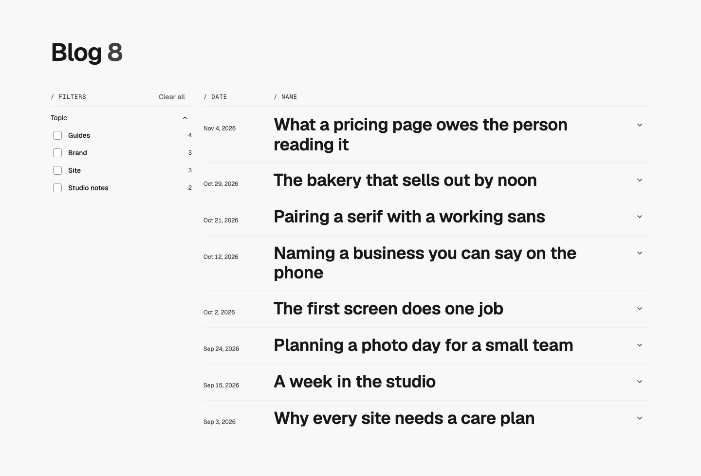
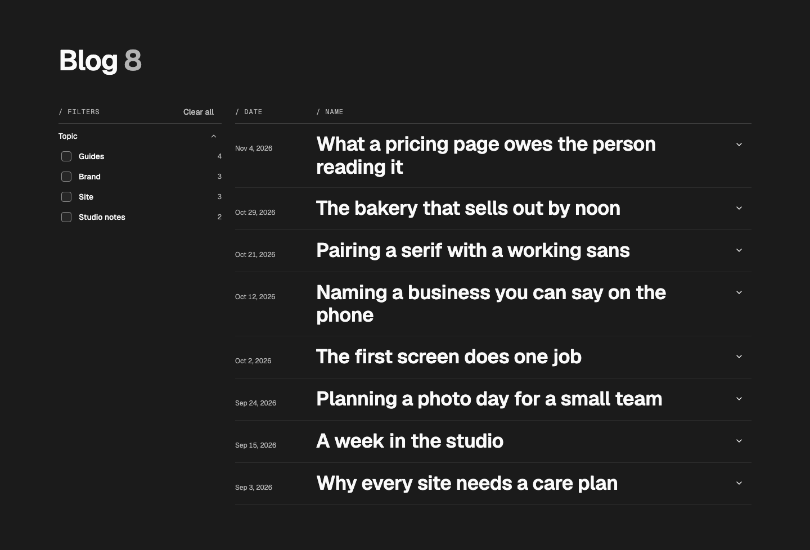
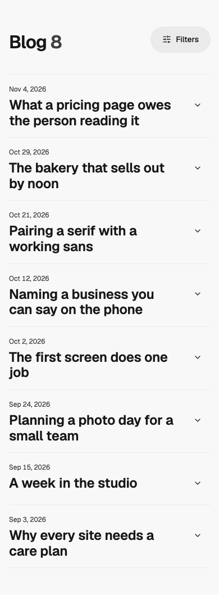

# Blog — Filtered Index

status: approved

Taken from whatmatters.so/blog (Randy, 2026-11-07: "I like how the blog and resources pages are already set up. I like that style."). The site pastes WMDS's Storybook "Pattern — filtered index"; this is that page as a wmds-patterns pattern, with every word a prop so a site can keep them in its copy file.
**File:** `BlogFilteredIndex.tsx` (copy it). **Example:** `example.tsx`, eight made-up studio posts under four topics.

The page's `main` on the WMDS page grid: the h1 with the count of shown posts beside it (muted, tabular), a WMDS `FilterPanel` rail on the first three columns from md (a Filters button and a sheet on phones), and the posts as a ruled WMDS `IndexList`: the date, the title as the link, and a one-line description. Ticking a topic filters the list at once; the count updates and is read out (a `role="status"` line).

| Light | Dark | Mobile (390) |
|---|---|---|
|  |  |  |

## Use it

```tsx
import Link from "next/link";
import { BlogFilteredIndex } from "./BlogFilteredIndex";

<BlogFilteredIndex
  title="Blog"
  groups={[{ id: "topic", label: "Topic", options: [{ value: "guides", label: "Guides" }, { value: "brand", label: "Brand" }] }]}
  posts={[
    { slug: "pricing-page", title: "What a pricing page owes the reader", href: "/blog/pricing-page", date: "2026-11-04", dateLabel: "Nov 4, 2026", description: "Three questions every visitor asks.", facets: { topic: ["guides"] } },
    // …newest first
  ]}
  renderLink={(post) => <Link href={post.href} />}
/>
```

## Slots and props

| Prop | Kind | Notes |
|---|---|---|
| `title` | ReactNode | The page's only h1, WMDS `type-display-2`. The count of shown posts follows it |
| `posts` | `BlogPost[]` | `slug`, `title`, `href`, `date` (ISO), `dateLabel`, `description` (one line), `facets` (options per group id). Newest first |
| `groups` | `FilterPanelGroup[]` | The filter groups and their options. Option counts are worked out from the posts |
| `defaultSelection` | `FilterSelection`, optional | Filters on when the page opens, e.g. from `/blog?topic=guides` |
| `selection` / `onSelectionChange` | optional | Hold the filters yourself (in the URL, say) |
| `renderLink` | function, optional | Your router's link for a post: `(post) => <Link href={post.href} />` |
| `overlay` | slot, optional | Page-level layers inside the grid (a grid overlay) |
| `labels` | object, optional | Every word: `count`, `filters`, `clear`, `show`, `list`, `dateColumn`, `titleColumn`, `empty`, `noMatch` |

## Adapt it

The first item is the example the gallery's Copy prompt uses.

- **Your posts:** read them from your content files, newest first, with their topics as `facets.topic`; make the topic filter's options from the topics in use.
- **Filters in the address:** read `?topic=` into `defaultSelection` (or hold `selection` in the URL) so a topic tag on a post can link to the filtered list.
- **No filters:** with one topic or fewer than six posts, drop the rail and pass `groups={[]}`; the list takes the full width if you change `listClasses` to `col-span-full`.
- **Animation:** none by default.

## Spacing

Page padding 24 / 40 / 56 (phone / tablet / desktop); title row → list 16 / 32. Rail 3 columns from md; the list takes 5 of 8 on tablet, 9 of 12 on desktop.
