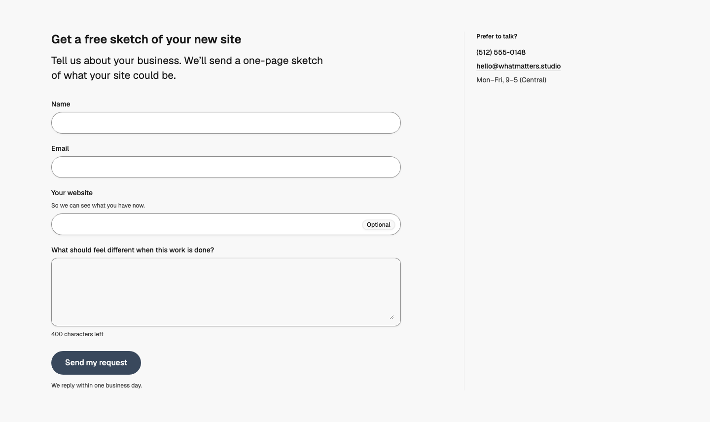
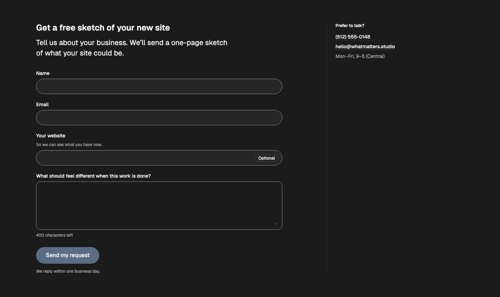
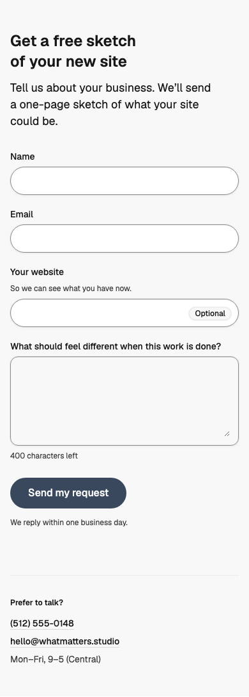

# Contact — Sketch Page

status: approved

The WhatMatters sketch request as its own page (Contact and booking forms rule, Rule 20). The nav and hero can still open the same form as a modal shortcut (WMDS `IntakeModal` with `useIntakeUrlState`), but the page exists too: it can be linked, bookmarked and refreshed.
**File:** `ContactSketchPage.tsx` (copy it). **Example:** `example.tsx`.

The heading and a one-line promise, then the form: WMDS `IntakeForm` fields, a hidden `IntakeHoneypot`, the "Send my request" button and the reply time under it. Other ways to reach the team (phone, email, hours) sit beside the form from `md` and below it on phones.

| Light | Dark | Mobile (390) |
|---|---|---|
|  |  |  |

## Use it

```tsx
import { IntakeForm, IntakeHoneypot } from "@thewhatmatters/wmds";
import { ContactSketchPage } from "./ContactSketchPage";

<ContactSketchPage
  heading="Get a free sketch of your new site"
  intro="Tell us about your business. We'll send a one-page sketch of what your site could be."
  fields={<><IntakeForm values={values} onChange={setValues} submitCount={submitCount} /><IntakeHoneypot value={trap} onChange={setTrap} /></>}
  contact={{ phone: "(512) 555-0148", email: "hello@whatmatters.studio", hours: "Mon–Fri, 9–5 (Central)" }}
  onSubmit={send}
/>
```

## Slots and props

| Prop | Kind | Notes |
|---|---|---|
| `heading` | ReactNode | The page's one `h1` (WMDS `type-heading-1`) |
| `intro` | ReactNode, optional | One sentence: what they'll get |
| `fields` | slot | WMDS `IntakeForm` (or Inputs in Fields) plus `IntakeHoneypot` |
| `submitLabel` | string, default "Send my request" | Says what happens; never "Submit" (T5) |
| `replyTime` | ReactNode, default "We reply within one business day." | Under the button (T2). Keep it true |
| `error` | ReactNode, optional | A failed send (T6): what happened, that answers are kept, and the email route |
| `contact` | `{ phone?, email?, hours? }`, optional | Beside the form from `md`, below it on phones (T1) |
| `contactHeading` | ReactNode, default "Prefer to talk?" | |
| `onSubmit` | form handler | Validate, and on failure count the press into `IntakeForm`'s `submitCount` (errors and an ErrorSummary show) |

## Adapt it

- **Another business's details:** swap the example's copy, contact details and reply time for the client's own, and keep the reply time honest.
- **A booking step:** one page up to about six fields. If booking a time follows, send the details first and make booking optional (WMDS `CalEmbed`, "Skip, just email me" above the calendar) (T7, T8).
- **Spam:** keep `IntakeHoneypot`, and on the server drop requests where it's filled, with rate limits. Never a CAPTCHA (T4).
- **After sending:** show WMDS `IntakeConfirmation` on its own screen with `summary`, `replyTime` and `contact`, and send a confirmation email (T3).
- **A modal shortcut:** `const [open, setOpen] = useIntakeUrlState("sketch")`, and pass `hasAnswers` so closing asks before discarding (T9).

## Notes

- Checked against **@thewhatmatters/wmds 0.4.35** (`IntakeHoneypot` shipped there).
- Uses WMDS base colours only. The failure message is a plain `role="alert"` block until WMDS has an inline alert (gap #51).
