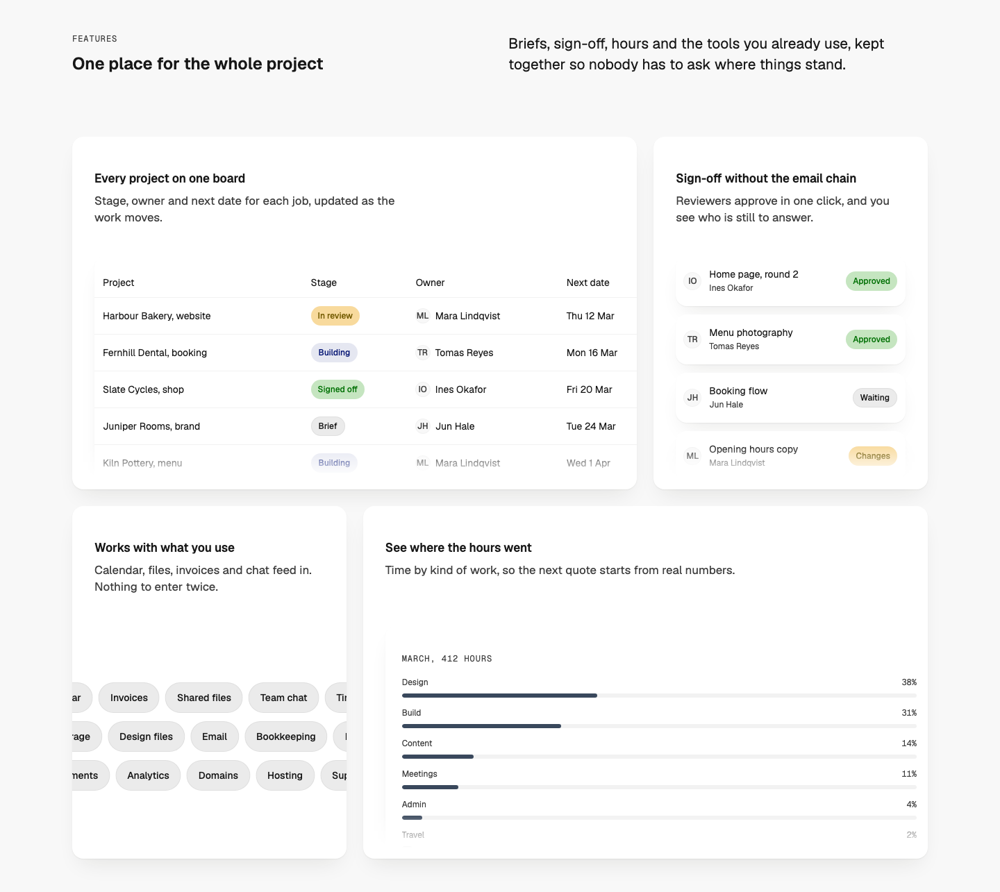
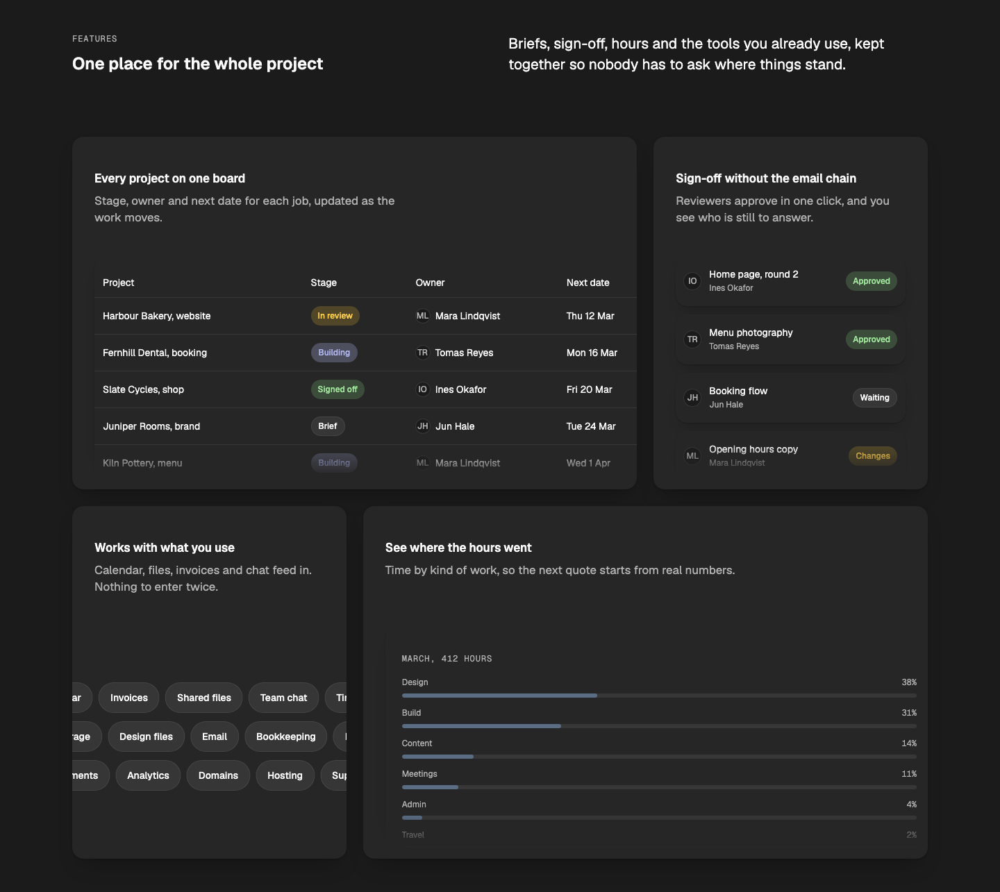

# Features — Bento

status: approved

A layout pattern: the bento grid is the pattern, and what sits in its cells follows the site's direction. After Hebbia's "knowledge at work" features section (details.so, https://details.so/inspo/hebbia-5a8069) for the grid, and the WhatMatters home's "one team" section for cells the reader can use. Nothing copied but the structure.
**File:** `FeaturesBento.tsx` (copy it). **Example:** `example.tsx`, a made-up client portal for a small studio, shown in two directions with the same words; every visual is built from WMDS components, so nothing in it needs a licence.

A WMDS `Band`: eyebrow and heading on the left half, a short intro on the right half (column 7). Under them, the features as a list of WMDS `Card`s on the page grid: wide + narrow (8 + 4 columns), then narrow + wide, so each row mirrors the one above. Two across on tablets, stacked on phones. Each cell holds the feature's name (`h3`), a line of description and a `visual` slot. The cells of a row share their rows (subgrid), so words and visuals line up across the row.

| Light | Dark | Mobile (390) |
|---|---|---|
|  |  |  |

## Variants

The example's two directions (the gallery's Variant control). The layout, the heading and the cells' words are the same; only the `visual` slots and `media` change.

| Variant | `media` | What the cells hold |
|---|---|---|
| `interactive` (default) | `"above"` | Small working demos: filter the project board, tick off a sign-off, switch the hours between week, month and quarter. The tools row wakes while the pointer is over its cell |
| `screens` | `"below"` | Still pictures of the product under the words, running off the cells' right and bottom edges |

## Use it

```tsx
import { Card, Chip } from "@thewhatmatters/wmds";
import { FeaturesBento, FeaturesBentoDrift } from "./FeaturesBento";

<FeaturesBento
  eyebrow="Features"
  heading="One place for the whole project"
  intro="Briefs, sign-off, hours and the tools you already use, kept together."
  media="above"
  items={[
    {
      title: "Every project on one board",
      description: "Stage, owner and next date for each job, updated as the work moves.",
      // Something the reader can use: it keeps its controls and its place in the tab order.
      visual: <ProjectBoardDemo />,
      interactive: true,
    },
    {
      title: "Works with what you use",
      description: "Calendar, files, invoices and chat feed in.",
      // A picture: hidden from assistive tech, out of the tab order.
      visual: (
        <FeaturesBentoDrift>
          <Chip size="lg" readOnly>Calendar</Chip>
          {/* more chips */}
        </FeaturesBentoDrift>
      ),
    },
    // 2 or 4 cells read best
  ]}
/>
```

## Slots and props

| Prop | Kind | Notes |
|---|---|---|
| `heading` | ReactNode | The section's `h2`, one short line (WMDS `type-heading-1`) |
| `eyebrow` | ReactNode | Optional: a short label above the heading |
| `intro` | ReactNode | Optional: a sentence or two on the right half (`type-lead`) |
| `items` | array | 2–4 cells in reading order (below). An odd last cell takes the full width |
| `items[].title` | string | The feature's name (an `h3`) |
| `items[].description` | ReactNode | One or two lines |
| `items[].visual` | ReactNode | The slot: whatever shows the feature. A still screen built from WMDS components, a photograph, a picture that moves on hover, a working demo |
| `items[].interactive` | boolean | Set it when the visual is something the reader can use. Default `false`: the visual is a picture |
| `items[].span` | `"wide"`, `"narrow"`, `"full"` | Optional: the cell's width from tablets up. Left out, cells take turns wide, narrow, narrow, wide |
| `media` | `"below"` (default), `"above"` | Where the visuals sit: under the words, running off the cell's bottom edge with a fade, or above the words in a frame closed by a rule |
| `fill` | `"surface"` (default), `"muted"` | The cells' fill. `surface`: the layout card, raised off the page. `muted`: WMDS's quiet card (muted background, hairline edge, no shadow), so the surface panels in the visuals stand out, as in the reference |
| `tone` | `"default"` (default), `"inverse"`, `"field"` | The WMDS Band tone |

`FeaturesBentoDrift` (optional, for a cell's `visual`): `children` (the row's items, drawn twice so it loops), `direction` (`"left"` default, `"right"`), `duration` (seconds per loop, default 40).

## Behaviour

- **A picture is a picture.** A cell's `visual` is `aria-hidden` and `inert` by default: nothing in it is read out or takes focus, so a table or a button inside it is safe. The title and description carry the meaning. A picture fills the box (256 / 288 / 320px at least; phone / md / lg) and is cut at its edges.
- **An interactive visual is real UI.** With `interactive`, the visual keeps its semantics and its place in the tab order, sets the box's height itself and is never faded or cut at the bottom. Label every control (`aria-label` on a group, a visible label on each field), announce what changes (`aria-live="polite"` on the line that changes), and keep the demo's height the same in every state, so the section doesn't jump as the reader uses it.
- **Layout:** stacked on phones; two equal cells per row from md; 8 + 4, then 4 + 8 from lg. The cells of a row are as tall as the tallest, and their visuals and words start on the same lines.
- **A list:** the cells are a `ul`, each feature an `li` holding an `article` with an `h3`.

Measured in the gallery frame for the `interactive` example: Tab goes through the stage control, the table, the four sign-offs and the period control, in reading order, and never into a picture; filtering the board (5, 2, 1 rows) and switching the period leave the section's height unchanged; no sideways scroll on the page from 320 to 1920 in either variant.

## Motion

Motion (`motion/react`, the WMDS peer). Transform only; no opacity, so nothing is hidden before JavaScript runs.

- **Settle:** each visual rises 32px into its cell once, as the cell comes a quarter on screen (0.7s, ease-out `0.23, 1, 0.32, 1`; the second cell of a row follows 80ms later). The server render is the finished state.
- **Drift (`FeaturesBentoDrift`):** the row glides sideways for 4.5s when it comes on screen, eases to a stop, and moves again only while a mouse pointer is over its cell. It never moves on its own for five seconds or more, so it needs no pause control (WCAG 2.2.2). Touch gets the arrival glide only.
- **Interactive visuals** answer at once: a filter or a tick changes the content with no transition of its own.
- **Reduced motion:** a still section: no rise, no drift. The demos still work.

## Knobs

- Visual height: `min-h-64 md:min-h-72 lg:min-h-80` (`VISUAL`). The bottom fade under the words is `VISUAL_FADE` (3rem); delete it for a hard cut.
- Cell widths: `CELL_WIDE` / `CELL_NARROW` (8 + 4 of 12 from lg), or `span` per item. Equal halves: set both to `lg:col-span-6`.
- Rise distance and timing: `RISE` (32) and the 0.7s in `Rise`.
- Cell padding: `p-6 md:p-8` on the text block; a panel in a picture lines up with it via `left-6 md:left-8`, and an interactive visual carries the same padding itself.

## Adapt it

The first item is the example the gallery's Copy prompt uses.

- **Pick the direction first, then fill the slots:** keep the layout and write each cell's `visual` in your site's own manner. A quiet product site: still screens (`media="below"`). A studio or a launch page: pictures that wake on hover, or demos the reader can use (`media="above"`, `interactive`).
- **Your product's own screens:** build each `visual` from the WMDS components your product uses (a `Table`, a list of `Card`s, a chart), with real-looking content; start a panel at the text edge and let it run off the right and bottom (`absolute -right-6 top-0 left-6 md:left-8`).
- **Screenshots or photographs:** an `` with `absolute inset-0 size-full object-cover`, or wider than the cell with `max-w-none` so the cell crops it.
- **Quiet cells:** `fill="muted"` when the visuals are panels (a table, a list of cards) and you want them, not the cells, to carry the light. Leave the default when a visual sits straight on the cell (a chart, a row of chips).
- **A working demo:** a small client component with its own state, built from WMDS controls (`SegmentedControl`, `Checkbox`, `Search`), marked `interactive`. Give it a fixed minimum height and two or three states, not a whole product.
- **One hero cell:** `span: "full"` on the first item, then two halves under it.
- **No moving row:** leave `FeaturesBentoDrift` out; the visuals still settle once.

## Spacing

Full width; Band `md` spacing (48 top and bottom); header → cells 40 / 64 (phone / md and up); cells one grid gutter apart both ways; cell text padding 24 / 32; title → description 8. With `media="above"` a 1px rule sits between the visual and the words.

## WMDS

Built on **@thewhatmatters/wmds 0.4.54** (npm): `Band`, `Card` (`padding="bare"` and `variant="muted"`, new in 0.4.54); the example adds `Table` (`fit`, new in 0.4.54), `Badge`, `Avatar`, `Chip`, `ChartRankedBars`, `SegmentedControl` and `Checkbox`. Motion 13 (already a dependency). No new library.

- **Check change:** `npm run check` has a rule for the Features type: one h2, the features as a list with an h3 each, no h1, no nav, and every `data-slot="visual"` is `aria-hidden` and `inert` unless it is marked `data-interactive`, in which case it must be neither.
- **Fixed in 0.4.54, and used here:** cells use Card `padding="bare"` (it replaced the `!py-0 !gap-0` overrides); `fill="muted"` is Card `variant="muted"`; the example's working board is a Table with `fit`, so its rows wrap in a narrow cell (at 320 the board is 240px wide in a 240px box; it scrolled 41px sideways before). SegmentedControl now carries a 44px tap layer on touch screens and takes arrow keys, and the active Badge measures 5.23:1 on the board in the dark theme (4.29:1 before).
- **Card.Media isn't used.** The visual box stays a plain `div` because it rides the cell's subgrid rows; WMDS 0.4.54's `Card.Media` (`bleed`, `fade`) fits a card without the shared rows.
- **WMDS-GAP: no short-run marquee.** WMDS `Carousel` autoplay drifts without end and brings a pause control on focus; a row that moves a few seconds on arrival and on hover has no WMDS part, so `FeaturesBentoDrift` lives in the pattern. Proposed: `autoplay={{ run: "arrival" | "hover" }}` on Carousel, or a small `Ticker`.
