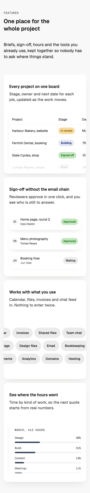

# Features — Bento

status: draft

After Hebbia's "knowledge at work" features section (details.so, https://details.so/inspo/hebbia-5a8069). Nothing copied but the structure: an offset grid of cells, each with a title, a line of description and a picture of the feature at work that runs off the cell's edge.
**File:** `FeaturesBento.tsx` (copy it). **Example:** `example.tsx`, a made-up client portal for a small studio; every picture is built from WMDS components (`Table`, `Badge`, `Avatar`, `Chip`, `ChartRankedBars`), so nothing in it needs a licence.

A WMDS `Band`: eyebrow and heading on the left half, a short intro on the right half (column 7). Under them, the features as a list of WMDS `Card`s on the page grid: wide + narrow (8 + 4 columns), then narrow + wide, so each row mirrors the one above. Two across on tablets, stacked on phones. Each cell holds the feature's name (`h3`) and description at its top, and below them a fixed-height picture, cut at the cell's edges with its last 3rem fading out.

| Light | Dark | Mobile (390) |
|---|---|---|
|  |  |  |

## Use it

```tsx
import { Card, Chip } from "@thewhatmatters/wmds";
import { FeaturesBento, FeaturesBentoDrift } from "./FeaturesBento";

<FeaturesBento
  eyebrow="Features"
  heading="One place for the whole project"
  intro="Briefs, sign-off, hours and the tools you already use, kept together."
  items={[
    {
      title: "Every project on one board",
      description: "Stage, owner and next date for each job, updated as the work moves.",
      visual: <Card variant="outlined" className="absolute -right-6 top-0 left-6 md:left-8">{/* your table */}</Card>,
    },
    {
      title: "Works with what you use",
      description: "Calendar, files, invoices and chat feed in.",
      visual: (
        <FeaturesBentoDrift>
          <Chip size="lg" readOnly>Calendar</Chip>
          {/* more chips */}
        </FeaturesBentoDrift>
      ),
    },
    // 2 or 4 cells read best
  ]}
/>
```

## Slots and props

| Prop | Kind | Notes |
|---|---|---|
| `heading` | ReactNode | The section's `h2`, one short line (WMDS `type-heading-1`) |
| `eyebrow` | ReactNode | Optional: a short label above the heading |
| `intro` | ReactNode | Optional: a sentence or two on the right half (`type-lead`) |
| `items` | array | 2–4 cells in reading order: `title` (an `h3`), `description` (one or two lines), `visual` (slot: a picture of the feature built from WMDS components; it fills the box under the text and is cut at its edges). An odd last cell takes the full width |
| `tone` | `"default"` (default), `"inverse"`, `"field"` | The WMDS Band tone |

`FeaturesBentoDrift` (optional, for a cell's `visual`): `children` (the row's items, drawn twice so it loops), `direction` (`"left"` default, `"right"`), `duration` (seconds per loop, default 40).

## Behaviour

- **The picture is a picture.** Each cell's `visual` is `aria-hidden` and `inert`: nothing in it is read out or takes focus, so a table or a button inside it is safe. The title and description carry the meaning; don't put anything a reader needs only in the picture.
- **Layout:** stacked on phones; two equal cells per row from md; 8 + 4, then 4 + 8 from lg. The picture box is 256 / 288 / 320px tall (phone / md / lg), so cells in a row end level.
- **A list:** the cells are a `ul`, each feature an `li` holding an `article` with an `h3`.

## Motion

Motion (`motion/react`, the WMDS peer). Transform only; no opacity, so nothing is hidden before JavaScript runs.

- **Settle:** each picture rises 32px into its cell once, as the cell comes a quarter on screen (0.7s, ease-out `0.23, 1, 0.32, 1`; the second cell of a row follows 80ms later). The server render is the finished state.
- **Drift (`FeaturesBentoDrift`):** the row glides sideways for 4.5s when it comes on screen, eases to a stop, and moves again only while a mouse pointer is over its cell. It never moves on its own for five seconds or more, so it needs no pause control (WCAG 2.2.2). Touch gets the arrival glide only.
- **Reduced motion:** a still section: no rise, no drift.

Measured in the gallery frame at 1440: pictures go 32 → 0 on arrival; drift rows stop 4.1–4.6s after arrival, move on hover and stop under a second after the pointer leaves; with reduced motion nothing moves.

## Knobs

- Picture height: `h-64 md:h-72 lg:h-80` (`VISUAL`). The bottom fade is the `mask-image` in the same constant (3rem); delete it for a hard cut.
- Cell widths: `CELL_WIDE` / `CELL_NARROW` (8 + 4 of 12 from lg). Equal halves: set both to `lg:col-span-6`.
- Rise distance and timing: `RISE` (32) and the 0.7s in `Rise`.
- Cell padding: `p-6 md:p-8` on the text block; a panel in the picture lines up with it via `left-6 md:left-8`.

## Adapt it

The first item is the example the gallery's Copy prompt uses.

- **Your product's own screens:** build each `visual` from the WMDS components your product uses (a `Table`, a list of `Card`s, a chart), with real-looking content; start a panel at the text edge and let it run off the right and bottom (`absolute -right-6 top-0 left-6 md:left-8`).
- **Screenshots instead:** an `` with `absolute top-0 left-6 md:left-8 max-w-none` and a width wider than the cell, so the cell crops it.
- **Two features:** pass two items; the row is 8 + 4.
- **No moving row:** leave `FeaturesBentoDrift` out; the pictures still settle once.

## Spacing

Full width; Band `md` spacing (48 top and bottom); header → cells 40 / 64 (phone / md and up); cells one grid gutter apart both ways; cell text padding 24 / 32; title → description 8; the picture box sits at the cell's bottom (`mt-auto`).

## WMDS

Built on **@thewhatmatters/wmds 0.4.50** (npm): `Band`, `Card`; the example adds `Table`, `Badge`, `Avatar`, `Chip` and `ChartRankedBars`. Motion 13 (already a dependency). No new library.

- **Check change:** `npm run check` has a rule for the new Features type (one h2, the features as a list with an h3 each, no h1, no nav, and every `data-slot="visual"` is `aria-hidden` and `inert`).
- **WMDS-GAP: Card has no quiet fill.** The reference sets white product panels on grey cells. WMDS `Card` variants `surface` and `outlined` both draw the surface colour, so here a panel inside a cell is told apart only by its soft shadow. Proposed: a `Card variant="muted"` (the page's muted background, no shadow).
- **WMDS-GAP: Card has no media slot that bleeds.** The picture box (fixed height, cut at the card's edges, bottom fade) is built in the pattern with `padding="none"` and a plain `div`. Proposed: `Card.Media` with `bleed` and `fade` options.
- **WMDS-GAP: no short-run marquee.** WMDS `Carousel` autoplay drifts without end and brings a pause control on focus; a row that moves a few seconds on arrival and on hover has no WMDS part, so `FeaturesBentoDrift` lives in the pattern. Proposed: `autoplay={{ run: "arrival" | "hover" }}` on Carousel, or a small `Ticker`.
