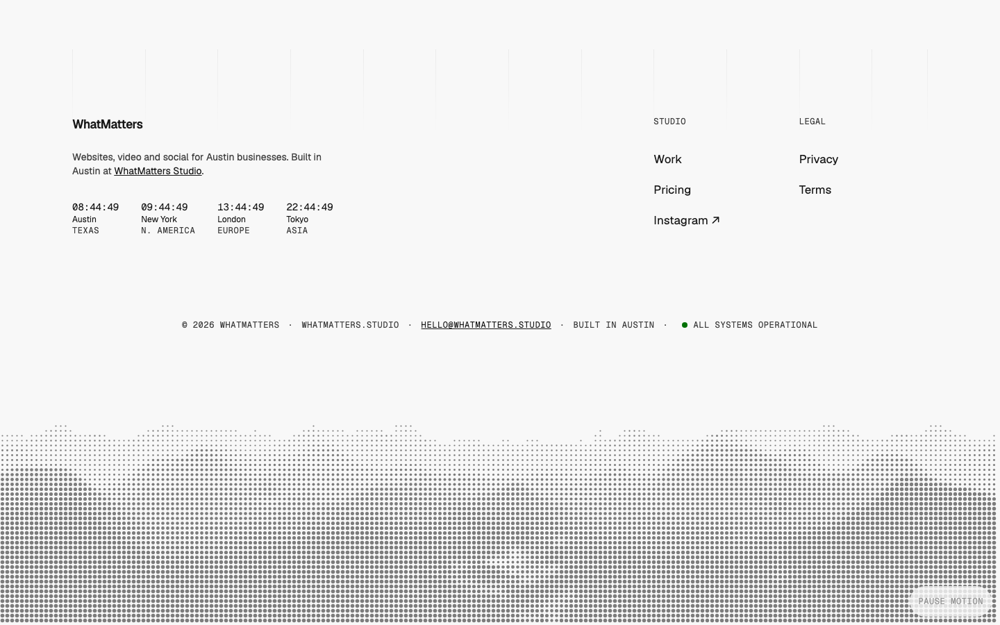
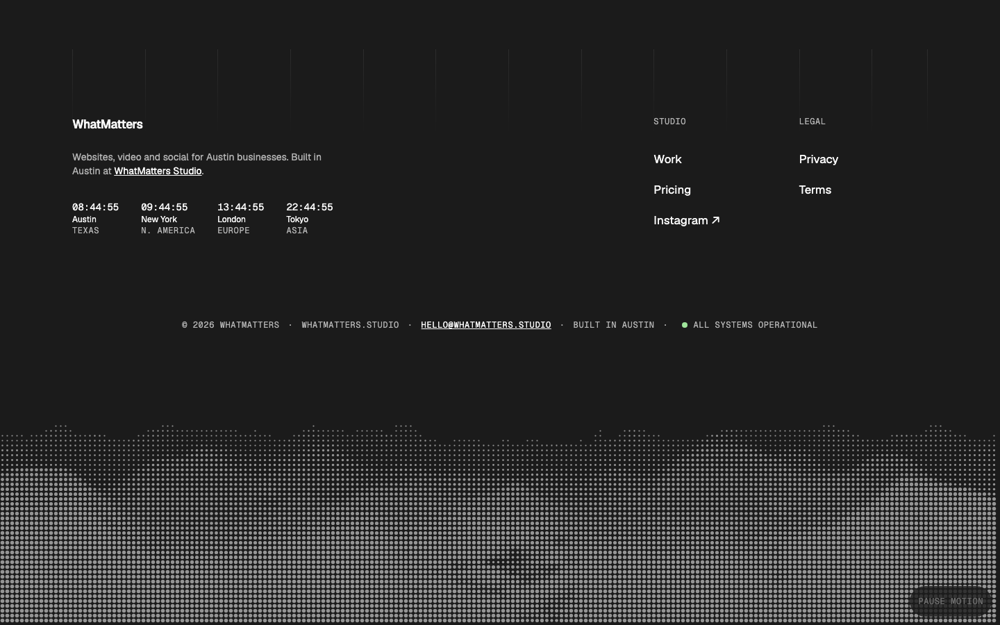
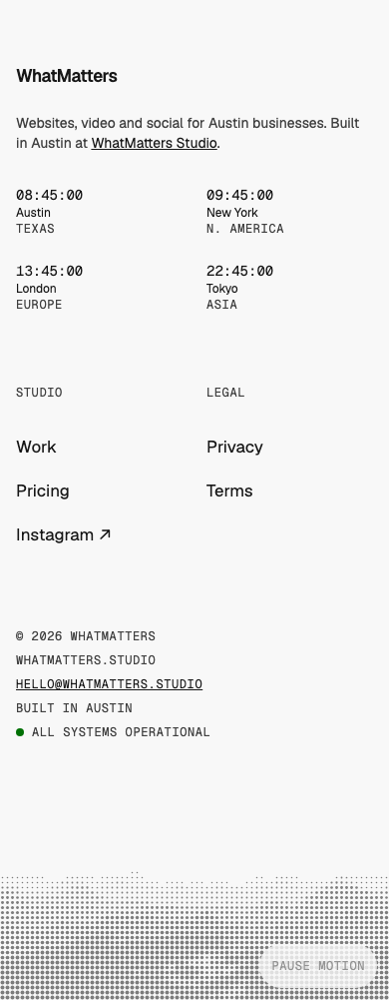

# Footer — Landscape

status: draft

After Pengon's footer (Inspiration #12), with our twist: the landscape is drawn live in dots from a video, the wm-tools ASCII media technique. Spec: Product Designer, 2026-10-27.
**File:** `FooterLandscape.tsx` (copy it; it holds `FooterLandscape`, `FooterClocks` and `FooterAsciiBand`). **Example:** `example.tsx`.

A calm footer on tinted paper: faint column rules at the top, brand and a one-line pitch, ticking world clocks, short link columns, a centred mono fact strip with a status dot, and a full-width landscape band that rises out of the paper and bleeds off the bottom.

| Light | Dark | Mobile (390) |
|---|---|---|
|  |  |  |

## Use it

```tsx
import { FooterAsciiBand, FooterClocks, FooterLandscape } from "./FooterLandscape";

<FooterLandscape
  brand={<Logo />}
  pitch="Websites, video and social for Austin businesses."
  clocks={<FooterClocks cities={[{ city: "Austin", region: "Texas", timeZone: "America/Chicago" }]} />}
  links={[{ label: "Studio", links: [{ label: "Work", href: "/work" }] }]}
  facts={["© 2026 WhatMatters", <a href="mailto:hello@…">hello@…</a>, "Built in Austin"]}
  status="All systems operational"
  moment={<FooterAsciiBand src="/landscape.mp4" poster="/landscape.jpg" />}
/>
```

## Slots and props

| Prop | Kind | Notes |
|---|---|---|
| `brand` | slot | The logo lockup; a co-brand is fine |
| `pitch` | ReactNode | One short line, about 40 characters wide; may hold an inline link |
| `clocks` | slot, optional | A small live detail, usually `<FooterClocks cities={…} />` (0–4 cities; 2×2 on phones). `<time>` per city with an aria-label; not a live region; HH:MM once a minute under reduced motion |
| `links` | `{ label, links: { label, href, external? }[] }[]` | 1–4 columns. 1–2 sit on the right; 3–4 take their own row. 44px tall hit areas |
| `facts` | ReactNode[] | The fact strip: dot-separated and centred from 768, stacked one per line on phones |
| `status` | ReactNode, optional | A green dot plus text at the end of the strip ("Status:" for screen readers) |
| `moment` | slot, optional | The band at the bottom, usually `<FooterAsciiBand src poster? ramp? threshold? />`. Leave it out to end on the strip |

`FooterAsciiBand`: `src` a looping landscape video (same-origin, or CORS), `poster` shown until the first frame and under reduced motion, `ramp` `"dots"` (default, reads as halftone) or `"classic"`, `threshold` (0–441, default 60) how far from the sky colour a pixel must be to get a dot. It draws in the text colour at 55% (45% in dark), 220 / 300 / 360px tall, the top 20% fading into the paper; pauses off-screen; a **Pause motion** toggle (WCAG 2.2.2: the loop runs past 5s).

## Knobs

- `--color-background-muted`: the paper. Set it per brand in brand.css.
- The band reads the sky colour from the video's top-left corner, so any plain sky works; raise `threshold` for a hazy one.

## Adapt it

The first item is the example the gallery's Copy prompt uses.

- **Different landscape:** pass another looping video to `FooterAsciiBand` (a clean silhouette on a plain sky; crop it to the ridges).
- **No clocks:** leave `clocks` out, or pass a status line or "now playing" instead.
- **Classic characters:** `ramp="classic"` reads as terminal rather than halftone.
- **No band:** leave `moment` out; the footer ends on the fact strip.
- **Four link columns:** they move to their own row under the brand.

## WMDS-GAPs

- Checked against **@thewhatmatters/wmds 0.4.27**. Muted text on the muted paper must hold 4.5:1; the check in this pattern's review measures it.
- Example clip: Envato "Abstract Mountain Range Flyover Animation" (Randy's pick, 2026-10-27). Until the licensed file is downloaded, the gallery plays Envato's preview from `gallery/public/local/` (not committed, not for publishing).
