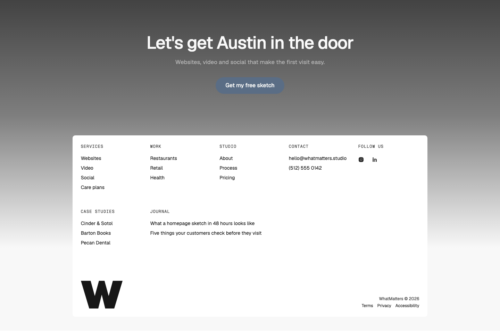
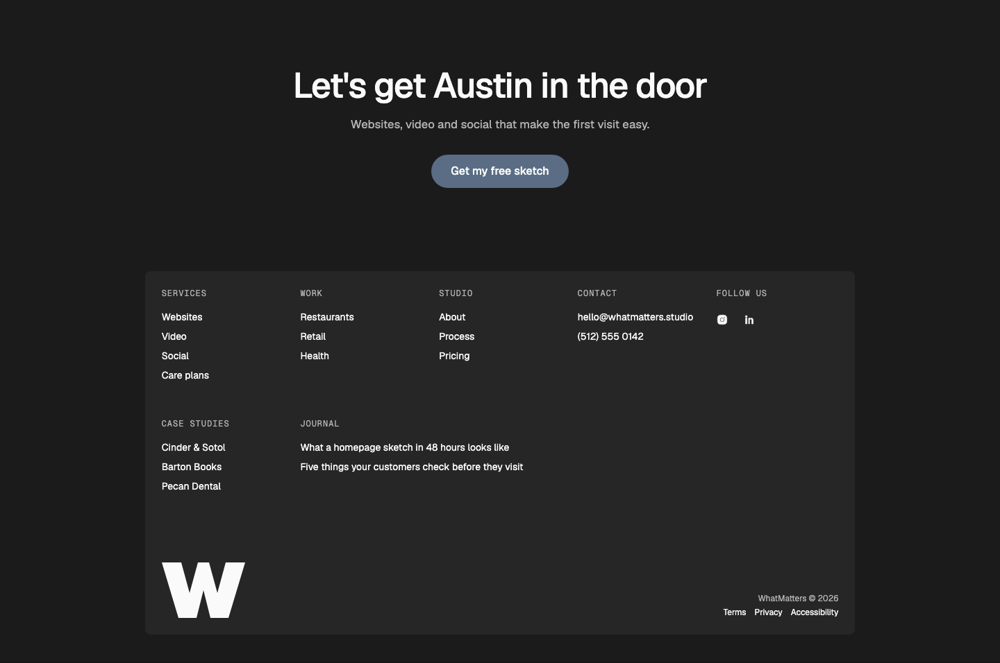
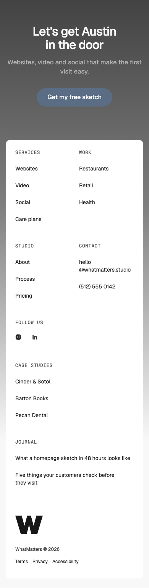

# Footer — Over Image

status: approved

After Unify's footer (Inspiration board; Randy's reference, 2026-10-27). Nothing copied but the idea.
**File:** `FooterOverImage.tsx` (copy it). **Example:** `example.tsx`, with Envato's "Blurred Restaurant Interior With Bartender in Background" (guyswhoshoot, Randy's pick) behind it.

A closing call to action set on a full-width picture or looping video, with the footer as a contained WMDS Card floating over the picture: link columns, a "Follow us" column, an optional second row (case studies, latest posts), a big brand mark at the bottom left and the legal line at the bottom right. The picture shows around the card and runs to the page's bottom edge.

| Light | Dark | Mobile (390) |
|---|---|---|
|  |  |  |

## Use it

```tsx
import { Button } from "@thewhatmatters/wmds";
import { FooterOverImage } from "./FooterOverImage";

<FooterOverImage
  video={{ src: "/footer.mp4", poster: "/footer.jpg" }}   // or media={}
  headline="Let's get Austin in the door"
  subhead="Websites, video and social that make the first visit easy."
  actions={<Button role="primary" size="lg" render={<a href="/start" />}>Get my free sketch</Button>}
  columns={[{ label: "Services", links: [{ label: "Websites", href: "/web" }] }]}
  logo={}
  copyright="WhatMatters © 2026"
  legal={[{ label: "Privacy", href: "/privacy" }]}
/>
```

## Slots and props

| Prop | Kind | Notes |
|---|---|---|
| `headline` | ReactNode | Optional. The closing line on the picture, an h2: one short sentence, WMDS `type-display-2`, about 16em wide |
| `subhead` | ReactNode | Optional. One line under it (two at most, broken at the sentence) |
| `actions` | slot, optional | One WMDS `<Button>` (two at most) |
| `video` | `{ src, poster? }`, optional | A decorative loop: muted, no controls, hidden from screen readers, paused off-screen, held on its poster under reduced motion |
| `media` | slot, optional | A decorative `` instead of `video`; cropped to fill (`object-cover`) |
| `columns` | `{ label, links: { label, href, external? }[] }[]` | The card's first row: 3–5 short columns of WMDS `TextLink`s (quiet), with muted labels |
| `follow` | slot, optional | A last first-row column, e.g. a "Follow us" label and WMDS `IconButton`s rendered as links. Small (36px) icons get an invisible 44px hit area on phones (`relative before:absolute before:-inset-1 md:before:hidden`), 8px apart so the areas don't overlap (Links K6) |
| `more` | columns, optional | A second row; a column with `wide: true` spans two grid columns for longer link text (post titles) |
| `logo` | slot | The big brand mark, bottom left: an SVG or `` with the brand's name as its accessible name, 48px tall on phones, 80px from tablet up |
| `copyright` | ReactNode | Bottom right |
| `legal` | `{ label, href }[]`, optional | Small legal links under the copyright |

Leave out `headline`, `subhead` and `actions` and the picture is just the frame around the card (no scrim).

## How it's built

- **Text on the picture** sits in a `data-theme="dark"` scope over a scrim made from the dark page colour (82% at the top, 55% a third of the way down, clear by three quarters), so the WMDS tokens (text, muted, Button) take their dark values and pass AA on any footage. The card follows the page's own theme.
- **The card** is WMDS `Card` (`padding="lg"`), 10 of 12 columns on desktop, full width with the page margin on phones.
- **Video** has no controls by design (ux-best-practices → Media).

## Adapt it

The first item is the example the gallery's Copy prompt uses.

- **Photo instead of video:** pass `media={}` and leave `video` out.
- **No call to action:** leave out `headline`, `subhead` and `actions`; the card sits at the top of the picture.
- **Fewer links:** three columns and no `more` row; the card gets shorter and the picture shows more.
- **Wordmark instead of a mark:** pass the full logo in `logo`; keep it about 80px tall on desktop.

## Spacing

Full width. Section padding 48 / 64 at the top (phone / tablet and up); headline→subhead 16, subhead→CTA 32, CTA→card 64 / 96; the card closes 24 / 40 above the page edge. Inside the card: column rows 40 apart, columns→bottom row 64 / 96.

## WMDS

- Built on **@thewhatmatters/wmds 0.4.28**: `Card`, `TextLink`, `IconButton`, `Button`. No gap.
- Example video: Envato "Blurred Restaurant Interior With Bartender in Background" (Randy's pick, 2026-10-27; https://app.envato.com/stock-video/24519876-74bd-432c-a8ad-01d142e906b0). Until the licensed file is downloaded, the gallery plays Envato's watermarked preview from `gallery/public/local/` (not committed, not for publishing). On the published gallery the picture stays empty until the licensed file is added at `gallery/public/examples/footer-over-image/` and the example points to it.

**Display copy (Rule 3, D7):** shorten, don't shrink. If your headline runs past 2 lines on phones, cut the words; keep the type step.
