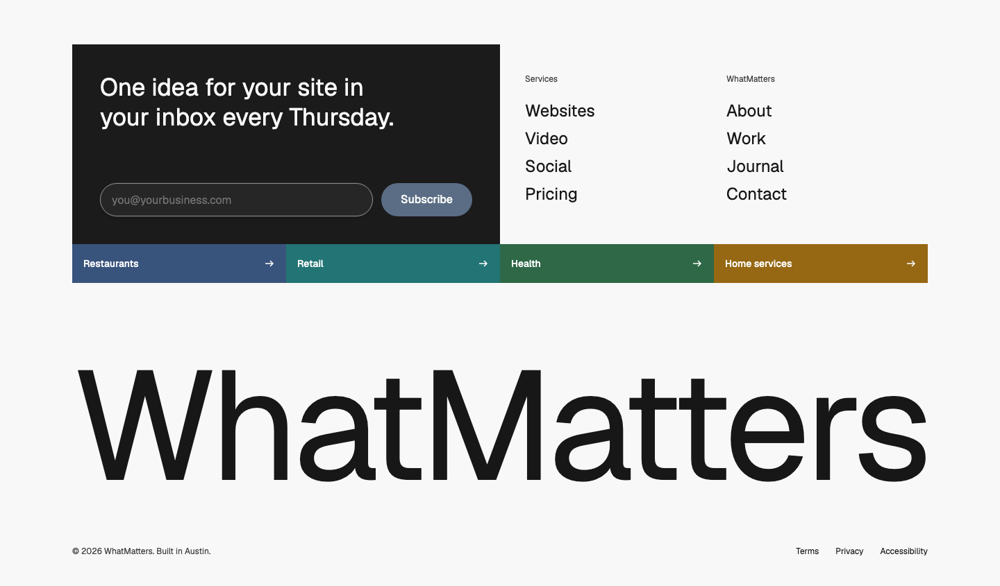
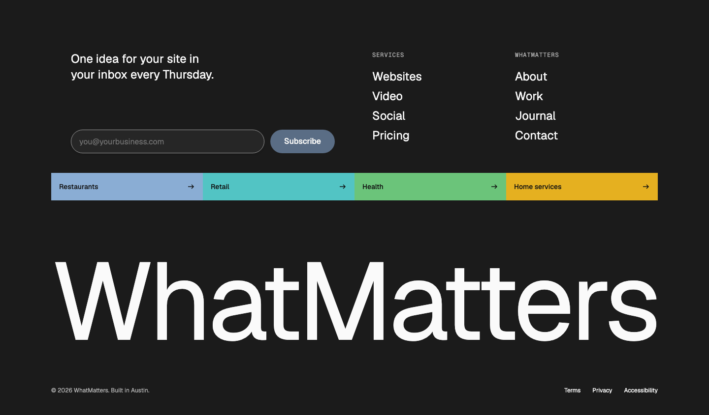
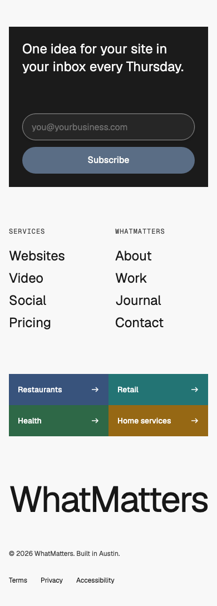

# Footer — Wordmark

status: approved

After Lexington's footer (lexingtonthemes.com, "Enlightr" viewport; Randy's reference, 2026-10-28). Nothing copied but the structure.
**File:** `FooterWordmark.tsx` (copy it). **Example:** `example.tsx`.

A dark newsletter card on the left half beside two columns of large links, a row of coloured category tiles hanging from the card, the brand name set edge to edge across the page, and a quiet legal line.

| Light | Dark | Mobile (390) |
|---|---|---|
|  |  |  |

## Use it

```tsx
import { FooterWordmark } from "./FooterWordmark";

<FooterWordmark
  pitch="One idea for your site in your inbox every Thursday."
  onSubscribe={(email) => subscribe(email)}
  columns={[{ label: "Services", links: [{ label: "Websites", href: "/web" }] }]}
  tiles={[{ label: "Restaurants", href: "/food", color: "var(--color-chart-categorical-1)" }]}
  name="WhatMatters"
  copyright="© 2026 WhatMatters"
  legal={[{ label: "Privacy", href: "/privacy" }]}
/>
```

## Slots and props

| Prop | Kind | Notes |
|---|---|---|
| `pitch` | ReactNode | The newsletter card's line: one sentence, WMDS `type-display-3`, about 18em wide |
| `onSubscribe` | `(email) => void` | Called with the email on submit; wire it to the newsletter provider. The field is a WMDS `Input` (type email, required, with a screen-reader label) and the button a WMDS `Button` |
| `status` | ReactNode, optional | A line under the form after submitting (sent, already subscribed, an error), announced politely |
| `emailLabel`, `placeholder`, `submitLabel` | string, optional | The field's spoken label, its placeholder, and the button's text |
| `columns` | `{ label, links }[]` | Two columns of 2–5 large WMDS `TextLink`s (quiet, `type-heading-1`) on the right half |
| `tiles` | `{ label, href, color }[]`, optional | 2–4 coloured category links (services, menus, locations); `color` is a WMDS colour token. In light mode the tile is that colour darkened 25% with white text (every example tile 4.9:1 or better); in dark mode it's the colour as is, with dark text |
| `name` | string | The brand name, set in the heading font and sized to fill the row at every width |
| `wordmark` | slot, optional | The brand's own logotype SVG instead of `name` |
| `copyright` | ReactNode | Bottom left |
| `legal` | `{ label, href }[]`, optional | Bottom right |

## Grid

On the WMDS page grid: the card takes the left half (columns 1–6, plus half a gutter so it's exactly two tiles wide), the link columns the right half starting on column 7, the tiles span the full width in four equal cells (two per row on phones and tablets), the wordmark spans the content width.

## Adapt it

The first item is the example the gallery's Copy prompt uses.

- **Serif, like the reference:** open the gallery's Fonts panel and try a serif for Headings (e.g. Newsreader or Instrument Serif); in your app, set `--font-family-heading` in brand.css.
- **No newsletter:** drop the card and let the link columns take the full width.
- **Logotype:** pass the brand's SVG in `wordmark`.
- **Tiles in brand colours:** pass the brand's tokens in `color`; the tile picks white or dark text by contrast; check that one of them clears 4.5:1 on each colour (a mid-tone can fail both).

## Spacing

Full width. Section padding 48 / 64 at the top; card padding 24 / 40; tiles 56px tall; wordmark 64 / 96 below the tiles; legal line 40 / 64 under the wordmark, 24 / 40 above the page edge.

## WMDS

- Built on **@thewhatmatters/wmds 0.4.28**: `Input`, `Button`, `TextLink`.
- **Gap: coloured category tile.** No WMDS component is a solid-colour link tile with an arrow (`LinkTile` is a card); the pattern draws them as plain links with a focus ring. Each tile's text is white or near-black, whichever contrasts more with the tile's colour as it renders (checked again when the theme changes); every example tile clears AA (4.5:1) in light and dark. WMDS has no "on-colour" ink token for chart colours, which would replace this.
- **Gap: fitted wordmark.** CSS can't fit text to a width; the pattern measures SVG text. A WMDS `Wordmark` (fit-to-width brand name) would replace it.
