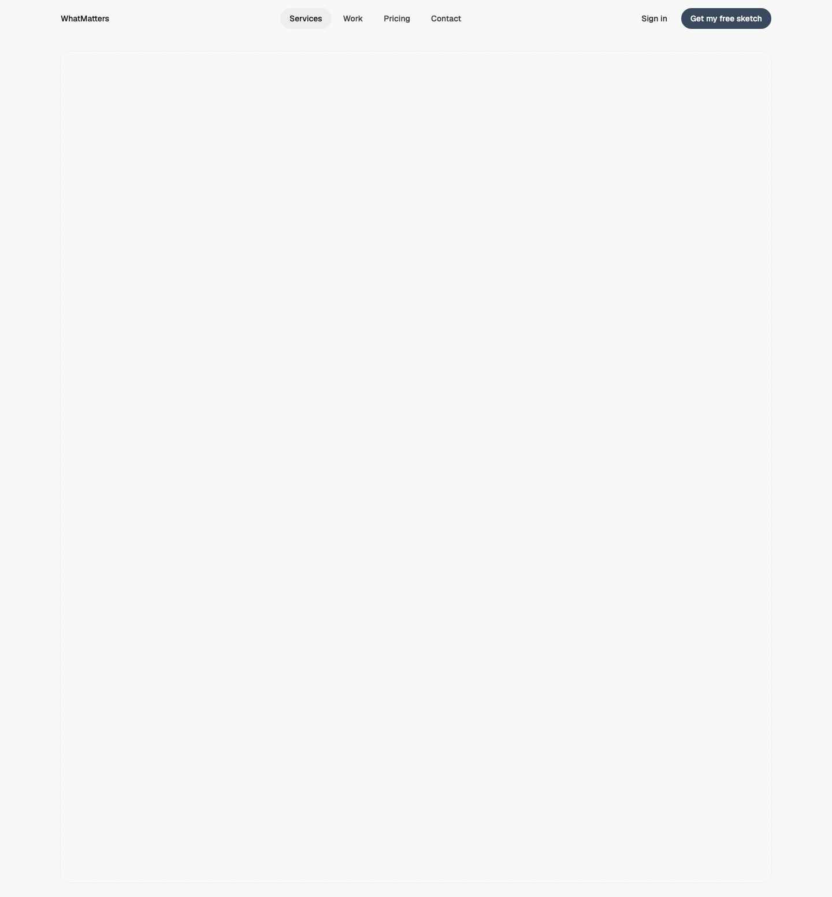
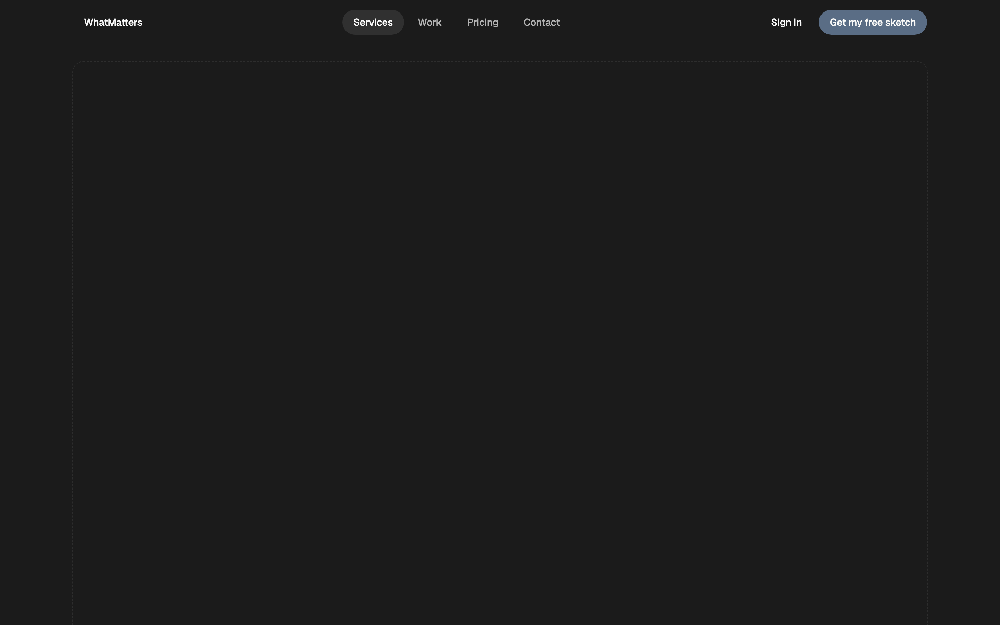
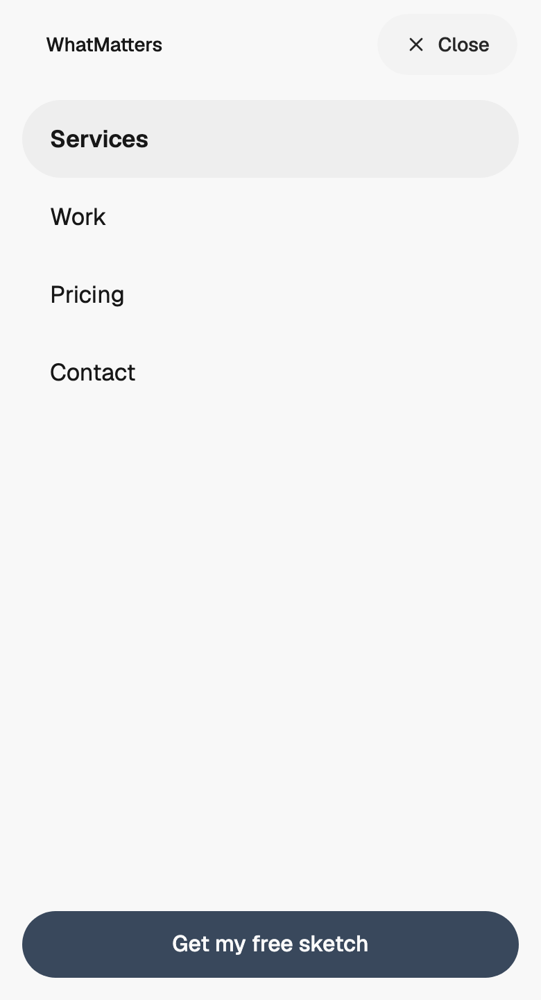

# Header — Mobile Menu

status: approved

Approved by Randy on 2026-10-29 ("for now this works"); a revisit is on his list (Tasks #41).

The site header Randy asked for ("We definitely need a mobile nav pattern"), built to the **Header and mobile menu rule** (Rule 12, 2026-10-28). WMDS `SiteNav` (0.4.31) does the behaviour; this pattern wires the links once for both the desktop bar and the phone menu.
**File:** `HeaderMobileMenu.tsx` (copy it). **Example:** `example.tsx`, over a placeholder page tall enough to scroll.

| Light | Dark | Mobile (390) |
|---|---|---|
|  |  |  |

## Use it

```tsx
import { Button, SiteNav } from "@thewhatmatters/wmds";
import { HeaderMobileMenu } from "./HeaderMobileMenu";

<HeaderMobileMenu
  brand={<SiteNav.Brand href="/">Cinder & Sotol</SiteNav.Brand>}
  links={[{ label: "Menu", href: "/menu", current: true }, { label: "Visit", href: "/visit" }, { label: "Private dining", href: "/private" }]}
  action={<Button role="primary" size="sm" render={<a href="/book" />}>Book</Button>}
  menuAction={<Button role="primary" size="lg" render={<a href="/book" />}>Book a table</Button>}
/>
```

## Slots and props

| Prop | Type | What it is |
|---|---|---|
| `brand` | slot | WMDS `SiteNav.Brand`: the wordmark link (never underlines) |
| `links` | `{ label, href, current? }[]` | The main links, key word first. **4 or fewer** so they also show on tablets; 5–7 at most |
| `action` | slot | The bar's main button, WMDS `Button size="sm"`. It stays in the bar on phones (N9): "Get my free sketch" (18 characters) fits beside Menu from 390, because the wordmark and the Menu word sit on the content edges. On a narrower phone (320–389) it gives way, by measurement, and `menuAction` carries it |
| `menuAction` | slot | The same action as a WMDS `Button size="lg"`, full width at the bottom of the open menu |
| `secondary` | slot, optional | A quieter link beside the action on desktop (Sign in, Contact); hidden on phones |
| `placement` | `"fixed"` \| `"inline"` | `fixed` (default): page chrome, in flow at the top, then the floating compact bar on scroll |

## Adapt it

- **A restaurant:** links Menu / Visit / Private dining, action "Book", menu action "Book a table".
- **Fewer links:** 3 links read best; never more than 7 (more than 4 move into the menu on tablets too).
- **No action:** pass a quiet link (`Button role="ghost"`) as `action` and the same as `menuAction`; keep one primary per screen.

## How it behaves (all WMDS SiteNav)

- **Desktop (`md`+):** every link in the bar, the current page in the selected fill with `aria-current="page"`. Never a menu button.
- **Phones:** "☰ Menu" (icon and word, 44px+) becomes "✕ Close" in the same place. The menu is a full-height panel under the bar: 56px rows, the current page in weight + fill, the main action pinned at the bottom.
- **The open menu is a dialog:** focus moves to the first link and cycles through the bar and the menu, the page behind is inert and doesn't scroll, Escape or Close closes it, **tapping any link closes it**, and focus returns to Menu.
- **Scrolled:** the floating compact bar keeps the wordmark, the action (when it fits) and Menu. No hide-on-scroll motion.

## Notes

- Screenshots and the review set (closed, open and scrolled at 320, 390, 786, 1024 and 1440, light and dark) are in Lead Engineer's `files/header-mobile-menu/`.
- Checked against **@thewhatmatters/wmds 0.4.34** (npm); `mobileAction` and the new phone menu shipped in 0.4.31.
- Not yet in WMDS: sub-pages that open in place with a back row (N8), and hover-open dropdowns with 0.5s delays (N4; SiteNav menus open on click today).
