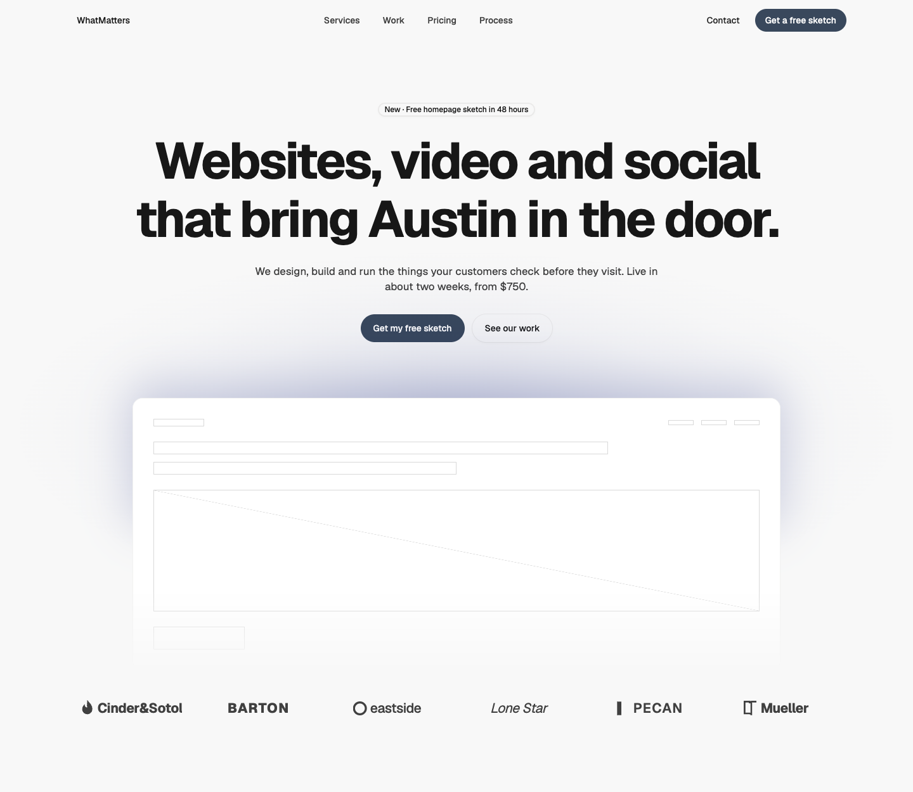
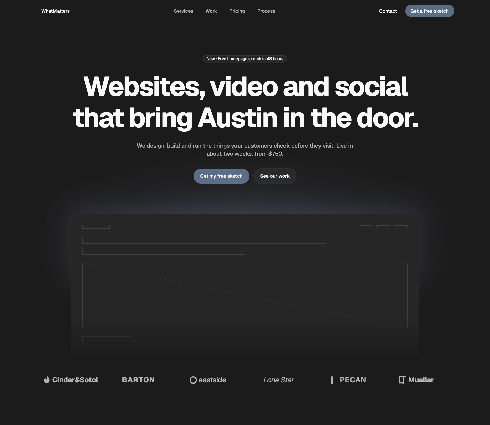
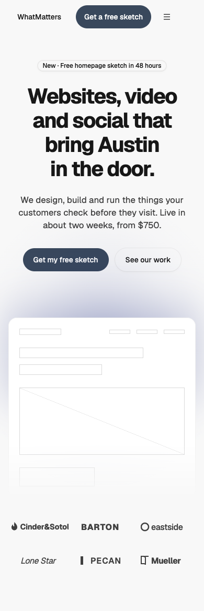

# Hero — Feature Center

**Status:** draft (Randy approved the look on 2026-10-26; the move out of WMDS is new).
**File:** `HeroFeatureCenter.tsx` (copy it). **Example:** `example.tsx` (filled in with placeholder content).

A centred hero: an eyebrow pill, a 2-line headline, a subhead and a CTA row, then the product in a framed window lit from behind, then an optional row of client logos.

| Light | Dark | Mobile (390) |
|---|---|---|
|  |  |  |

## Use it

```tsx
import { Button } from "@thewhatmatters/wmds";
import { HeroFeatureCenter, HeroFeatureCenterLogos } from "./HeroFeatureCenter";

// Under the page's existing nav: leave `nav` empty.
<HeroFeatureCenter
  eyebrow="New · Free homepage sketch in 48 hours"
  headline="Websites, video and social that bring Austin in the door."
  subhead="We design, build and run the things your customers check before they visit."
  actions={
    <>
      <Button role="primary" render={<a href="/sketch" />}>Get my free sketch</Button>
      <Button role="secondary" render={<a href="/work" />}>See our work</Button>
    </>
  }
  visual={}
  logos={<HeroFeatureCenterLogos logos={[{ name: "Cinder & Sotol", logo: <CinderMark /> }]} />}
/>
```

## Slots and props

| Prop | Kind | Notes |
|---|---|---|
| `nav` | slot, optional | Leave it empty when the page already has a nav (the usual case). For a standalone page pass a `<SiteNav>`; on the brand surface give it `tone="inverse"` |
| `eyebrow` | ReactNode | A short line shown as a pill (Badge) |
| `headline` | ReactNode | The page's only H1. Static |
| `subhead` | ReactNode | Regular weight, about 42rem wide |
| `actions` | slot, optional | The CTA row: any buttons or links. When set, `primaryAction` / `secondaryAction` are ignored |
| `primaryAction` / `secondaryAction` | `{ label, href }` | Shorthand for a primary and a secondary button |
| `visual` | slot, optional | What goes in the framed window: product shot, site, video. Decorative (`aria-hidden`) unless you change that |
| `logos` | slot, optional | Proof under the visual. `<HeroFeatureCenterLogos logos={[{ name, logo }]} />` (6 is typical; 3 per row on phones, 6 at desktop; a short row centres), or a marquee, a quote, a stats row |
| `surface` | `"page"` \| `"brand"` | `page` (default) follows light/dark; `brand` puts the hero on the dark brand surface |

## Knobs

- `--text-display-1-size`: the headline uses WMDS `type-display-1` (fluid 40px → 80px). About 58 characters take 2 lines from 1024px up, 3 on tablets, 4 on phones. Lower it for a longer headline.
- `--hero-glow`: the backlight colour. Default: a light tint of `--color-brand-outline` on the page surface; on the brand surface, the primary pulled toward the ink.
- WMDS brand knobs as usual: `--radius-control`, `--radius-surface`, `--font-family-*`, `--color-primary`, `--color-brand-surface`.

## Adapt it

- **Different copy:** change the props. If the headline runs past 2 lines at desktop, shorten it or lower `--text-display-1-size`.
- **More or fewer logos:** pass more or fewer to `HeroFeatureCenterLogos`. Over about 8, use a marquee in the `logos` slot instead of more rows.
- **Marquee:** put any marquee in the `logos` slot; nothing else changes.
- **No product visual:** leave `visual` empty; the logos follow the CTAs.
- **One CTA, or three:** whatever you put in `actions`.
- **Animation:** none by default. Add it in your copy (e.g. wrap the headline in WMDS `TextSequence`, or ease the visual in with `motion`).

## Spacing

Nav→eyebrow 48 / 96 (phone / desktop), headline→subhead 24, subhead→CTAs 32, CTAs→visual 64, visual→logos 24 (the frame's faded foot already reads as space), logos→next section 64 / 96.

## WMDS-GAPs

- `--hero-glow` is a pattern knob, not an allow-listed WMDS knob.
- On the brand (inverse) surface the CTA should be the light ink; today a site sets `--color-primary` / `--color-on-primary` under `[data-tone="inverse"]` in its brand.css. A per-tone primary knob is an open WMDS gap.
- CSS can't fit a headline to a line count; long headlines need a smaller size by hand.
- Needs WMDS **0.4.28+** (`Band`, `SiteNav.Brand wordmark`); 0.4.27 on npm doesn't have them.
