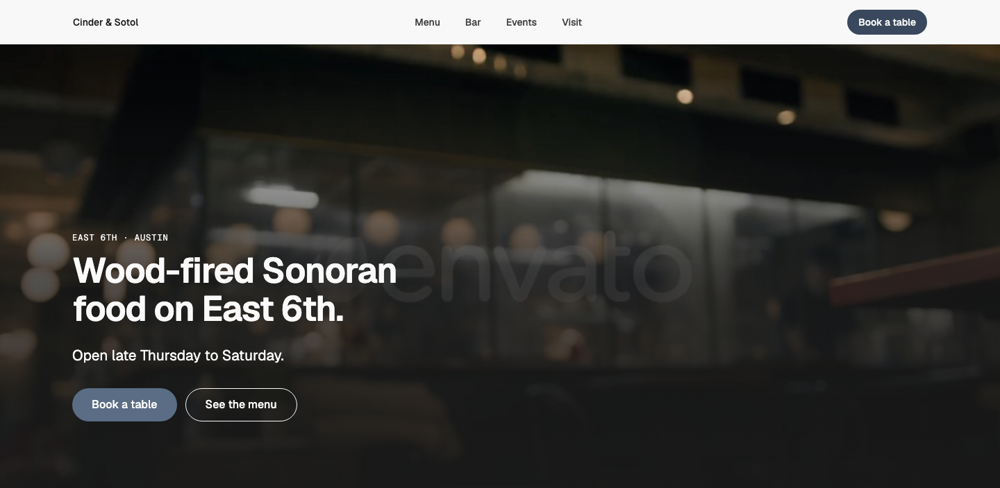
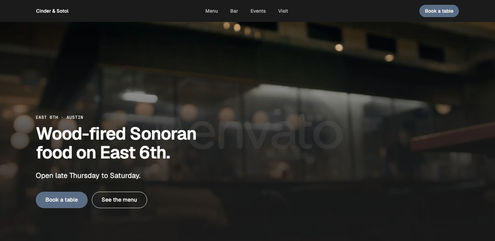
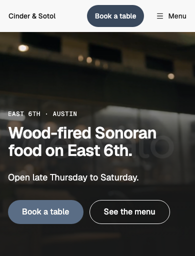

# Hero — Over Media

status: draft

Built to Product Designer's spec (`hero/over-media`, Tasks #43, WMDS gap #47) on WMDS 0.4.31.
**File:** `HeroOverMedia.tsx` (copy it). **Example:** `example.tsx`: a restaurant on East 6th over Randy's Envato pick ("Blurred Restaurant Interior With Bartender in Background"). The clip is a licensed preview kept in `gallery/public/local/`, never committed; without it the gallery shows the dark page colour behind the copy.

The atmosphere hero (Hero R7): a full-width photo or looping video with the copy left-aligned at its bottom left on the page grid (columns 1–7 from desktop), over a bottom-up scrim that keeps every letter readable (Display D8, Hero R5).

| Light | Dark | Mobile (390) |
|---|---|---|
|  |  |  |

## When to use it (Hero R7)

Food, places, a room people come to: when the atmosphere is the pitch. For a services business with work to show, use **Hero — Split**; for a short headline with no picture, a **centred** hero.

## Use it

```tsx
import { Button } from "@thewhatmatters/wmds";
import { HeroOverMedia } from "./HeroOverMedia";

<HeroOverMedia
  eyebrow="East 6th · Austin"
  headline="Wood-fired Sonoran food on East 6th."
  lead="Open late Thursday to Saturday."
  primaryAction={<Button role="primary" size="lg" render={<a href="/book" />}>Book a table</Button>}
  secondaryAction={<Button role="outline" size="lg" render={<a href="/menu" />}>See the menu</Button>}
  video={{ src: "/room.mp4", poster: "/room.jpg" }}   // or media={}
  focus="50% 40%"
/>
```

## Slots and props

| Prop | Kind | Notes |
|---|---|---|
| `nav` | slot, optional | Leave it empty when the page already has a nav. For a standalone page pass a WMDS `<SiteNav>` with `mobileAction` |
| `eyebrow` | ReactNode | Optional. 1–4 words in sentence case, 12px above the headline. Plain `type-eyebrow` unless `eyebrowHref` is set (then one outlined pill link, E10) |
| `eyebrowHref` | string, optional | Where the eyebrow links |
| `headline` | ReactNode | The page's only H1: **12 words at most**, 2 lines from 600px, 3 on phones (D6, D7). WMDS `type-display-2` |
| `lead` | ReactNode | Optional. 1–2 sentences, in the light ink on the scrim |
| `primaryAction` | slot | One WMDS `<Button role="primary" size="lg">` (R2, U7) |
| `secondaryAction` | slot, optional | One WMDS `<Button role="outline" size="lg">`; in the dark scope its border is the light ink, 3:1 or more (U4) |
| `media` | slot | A decorative `` with width and height; cropped to fill (`object-fit: cover`, never stretched, W7) |
| `video` | `{ src, poster? }`, optional | A decorative loop instead of `media`: muted, no controls, plays only on screen, holds its poster under reduced motion |
| `focus` | string, optional | The part of the picture to keep in view as it crops (`object-position`, e.g. `"50% 30%"`) |
| `fullHeight` | boolean, default `false` | The screen height less 64px, so the next section's edge shows, with a scroll cue (R9, R4). Off by default: the hero is its content plus Band `lg` spacing over a picture at least 28rem tall (36rem from tablet, 40rem from desktop) |

## Contrast (D8, R5)

The scrim is the dark page colour, 90% at the bottom, 74% halfway up, clear at the top. Over every half second of the example video, the worst pixel behind each part measured: **headline 5.7:1** (390) / **6.6:1** (1440), **lead 8.9:1 / 11.3:1**, actions **13.5:1**. For your own footage, check the brightest frame, not the poster; if the headline drops under 3:1, raise the scrim's middle stop.

## Adapt it

The first item is the example the gallery's Copy prompt uses.

- **Photo instead of video:** pass `media={}` and set `focus` to keep the subject in view on phones.
- **Full screen:** set `fullHeight` for a landing page that opens on the room; the scroll cue and the next section's edge show.
- **Light footage:** keep the scrim; the copy stays in the dark-theme scope on any picture.
- **Animation:** none beyond the video. Keep the loop calm; a video over 5 seconds that a page needs paused should get a pause control in your page (WCAG 2.2.2).

## WMDS-GAPs

- **Media component:** no WMDS image or video component with a focal point, a poster under reduced motion and a pause control; the pattern carries its own small player and `focus` prop until WMDS has one.
- Checked against **@thewhatmatters/wmds 0.4.32** (npm).
