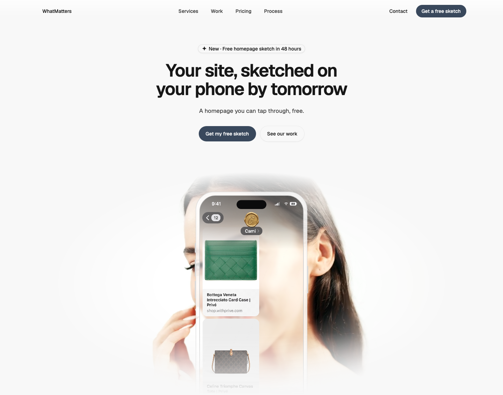
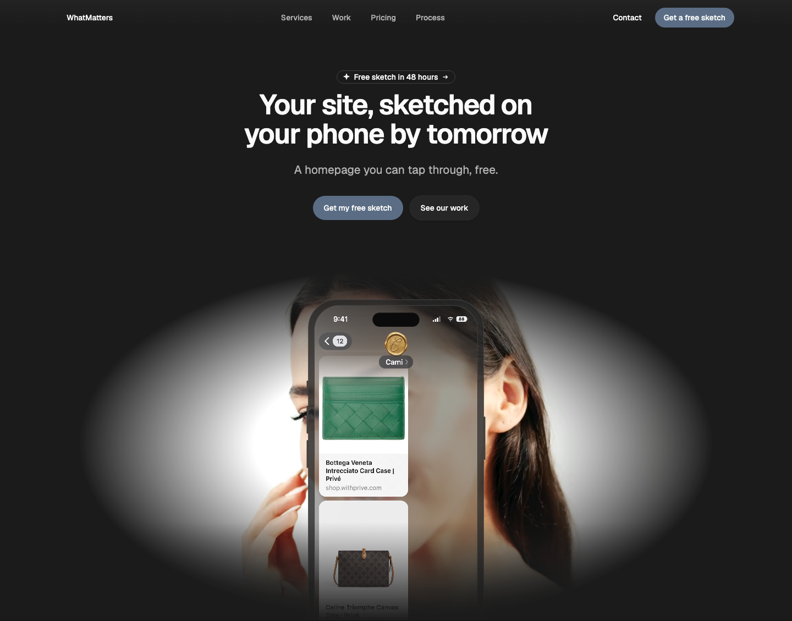
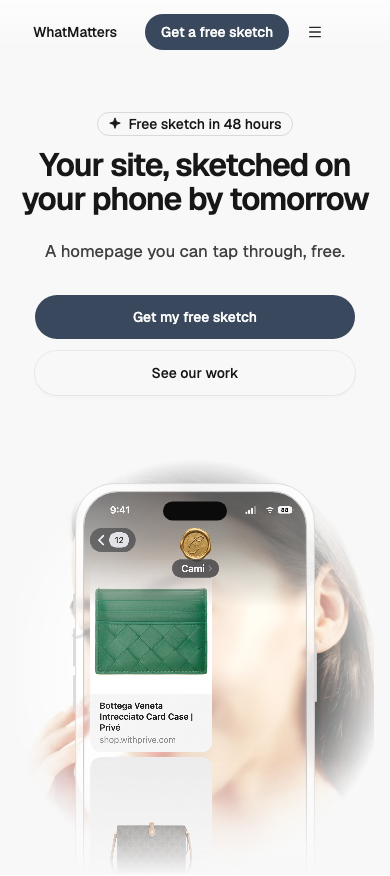

# Hero — Phone Center

status: approved

Structure from lovi.care's hero (Randy's reference, 2026-10-26); nothing copied but the idea.
Randy approved it in the gallery on 2026-10-27.
**File:** `HeroPhoneCenter.tsx` (copy it). **Example:** `example.tsx`: Mixkit's free clip 9101 (Mixkit License) behind the phone, and in it Motion Designer's see-through chat with Cami (`gallery/public/examples/phone-center/`, an alpha video in HEVC and VP9); shown in light only (see Light and dark).

A centred hero for an app or a mobile-first service: an eyebrow pill, a headline, a subhead and a CTA row, then a wide photo or video that fades into the page, with an iPhone frame over its centre. The media shows through the phone's glass screen, and a caption can sit on the screen. The whole stage fades out at its foot, like a fold.

| Light | Dark | Mobile (390) |
|---|---|---|
|  |  |  |

## Use it

```tsx
import { Button } from "@thewhatmatters/wmds";
import { HeroPhoneCenter } from "./HeroPhoneCenter";

// Under the page's existing nav: leave `nav` empty.
<HeroPhoneCenter
  eyebrow="Beauty award winner"
  headline="Science-backed skin care you can trust"
  subhead="Focused on you and your skin."
  actions={<Button role="primary" size="lg" render={<a href="/app" />}>Get the app</Button>}
  video={{ src: "/hero.mp4", poster: "/hero.jpg" }}   // or media={}
  screen="Face scan in progress…"
/>
```

## Slots and props

| Prop | Kind | Notes |
|---|---|---|
| `nav` | slot, optional | Leave it empty when the page already has a nav (the usual case). For a standalone page pass a `<SiteNav>` |
| `eyebrow` | ReactNode, optional | 1–3 words (about 28 characters) in sentence case, 12px above the headline. Plain WMDS `type-eyebrow` label unless `eyebrowHref` is set |
| `eyebrowHref` | string, optional | Where the eyebrow links (an offer, an announcement). With it, the eyebrow is an outlined pill link (WMDS Badge `md`, 24px tall) with a trailing arrow; a pill never appears without a link (Eyebrow E10) |
| `eyebrowIcon` | slot, optional | A small icon at the start of the eyebrow pill: a Lucide icon or a 16px `currentColor` SVG (WMDS Badge `icon`) |
| `headline` | ReactNode | The page's only H1, narrow like the phone: WMDS `type-display-2` (32px → 50px) set tight (-0.035em, line height 1.05), about 11em wide, 2–3 lines. Static. `hyphens-auto` needs the page's `lang` |
| `subhead` | ReactNode | One short line, about 40 characters (like Lovi's). Regular weight |
| `actions` | slot, optional | The CTA row: at most two buttons (make a third a text link) or app-store badges. On phones they stack full width |
| `media` | slot | The picture behind the phone, usually decorative: `` (give real alt text only if it carries meaning). Cropped to fill the stage (`object-cover`) and faded at every edge |
| `video` | `{ src, poster? }`, optional | A looping background video instead of `media`: muted, `playsInline`, no controls, hidden from screen readers. It holds on its poster under `prefers-reduced-motion`. No pause control, by Randy's call; a page that needs WCAG 2.2.2 (moving content over 5 seconds) should add one |
| `screen` | slot, optional | A short caption on the phone's screen: about 40 characters, 3 lines at most, on a scrim so it reads over any picture. If it changes (a status), wrap it in `aria-live="polite"` |
| `app` | slot, optional | A full app screen on the phone, edge to edge under the glass: a screenshot, a 9:19.5 screen recording (e.g. 1206 × 2622) or live UI. A recording that plays on its own for over 5 seconds needs a pause control in your page |
| `edgeBlur` | boolean, default `false` | A progressive blur along the top of the viewport: content scrolling up under it blurs and fades out (like Lovi). Static CSS, no script. Once per page; skip it if the page's sticky nav already covers the top |

## Knobs

- `--text-display-2-size`: the headline uses WMDS `type-display-2` (fluid 32px → 50px).
- The phone's width is `clamp(15rem, 24vw, 20rem)` and the stage's height `clamp(26rem, 52vw, 40rem)`, in `phoneClasses` and `stageClasses`: change them together.
- `--hero-screen-tint`: how much the frosted glass behind an `app` screen hides the media (default `45%`, `0%` for clear glass).
- The phone frame takes its bezel from `--color-surface` and its outline from `--color-border-emphasized`, so it follows the theme and the brand kit.

## Adapt it

The first item is the example the gallery's Copy prompt uses.

- **App screen instead of a caption:** put a screenshot or a screen recording in `app` (it fills the screen edge to edge); keep `media` behind it or leave it empty.
- **See-through app recording (like Lovi):** export the recording with an alpha channel so the media shows through the app's background: HEVC with alpha (`.mov`, Safari) and VP9 with alpha (`.webm`, Chrome, Firefox). List the HEVC source first, since Safari plays VP9 without its alpha:
  `<video autoPlay muted loop playsInline aria-hidden poster="…-poster.png"><source src="….mov" type='video/mp4; codecs="hvc1"' /><source src="….webm" type="video/webm" /></video>`
- **Different copy:** change the props; keep the headline to about three lines.
- **Video:** pass `video={{ src, poster }}`; it plays on its own, and holds still under reduced motion.
- **No media:** leave `media` and `video` empty; the phone stands on the page alone, its screen filled.
- **App-store badges:** put them in `actions` (official badge artwork, each a link with an accessible name).
- **Animation:** none by default. Add it in your copy (e.g. ease the phone up into place with `motion`).

## Light and dark

The pattern follows the theme, but the media doesn't: footage shot on a white studio background glows like a spotlight on a dark page. Use footage shot on a background close to the page colour: light footage for a light page, dark footage for a dark one. The gallery example (white-studio footage) is shown in light only.

## Spacing

Section padding 48 / 64 at the top (phone / tablet and up; the fading stage is the bottom edge), headline→subhead 24, subhead→CTAs 32, CTAs→stage 40 / 64. The stage is `clamp(26rem, 52vw, 40rem)` tall and fades out over its last 28%.

## WMDS-GAPs

- The eyebrow uses WMDS Badge `md`, the largest size. A Lovi-sized pill (about 36px) needs a larger Badge size in WMDS.

- No WMDS media component (image or video with poster, a pause control, reduced-motion handling); the pattern carries its own small video player until WMDS has one.
- No WMDS device frame; the iPhone outline is SVG inside the pattern.
- Checked against **@thewhatmatters/wmds 0.4.30** (npm).

**Display copy (Rule 3, D7):** shorten, don't shrink. If your headline runs past 3 lines on phones, cut the words; keep the type step.
