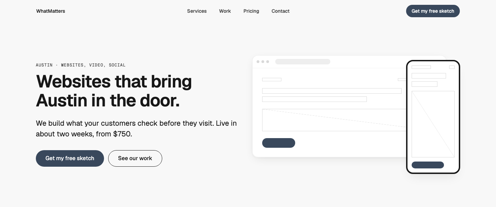
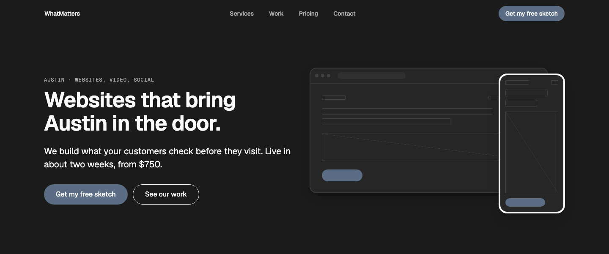
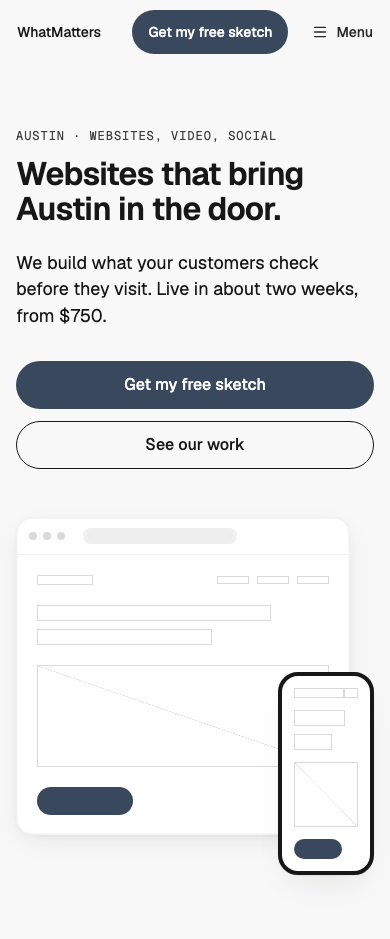

# Hero — Split

status: approved

Built to Product Designer's spec (`hero/split`, Tasks #43, WMDS gap #47) on WMDS 0.4.31.
**File:** `HeroSplit.tsx` (copy it). **Example:** `example.tsx`: WhatMatters' own pitch beside a hairline homepage sketch in a browser frame, with the phone version over its corner (licence-free; replace it with real work).

The default hero for services (Hero R7): left-aligned copy (an eyebrow, the headline, a lead, one primary action and an optional secondary) beside the real thing (R8), the client's work in a frame, a product screen or the homepage sketch. Stacked on phones and tablets, side by side from desktop.

| Light | Dark | Mobile (390) |
|---|---|---|
|  |  |  |

## Split, centred or over media (Hero R7)

- **Split** (this one): a services business, or anything with real work, a product or the sketch to show. The default.
- **Centred** (Hero — Feature Center, Hero — Phone Center): a headline of 2 lines or fewer and no picture, or one product shot under it. If you have no real picture, use a centred hero without one; never fill the visual with stock or filler (R8).
- **Over media** (Hero — Over Media): food, places, a room people come to, where the atmosphere is the pitch.

## Use it

```tsx
import { Button } from "@thewhatmatters/wmds";
import { HeroSplit } from "./HeroSplit";

// Under the page's existing nav: leave `nav` empty.
<HeroSplit
  eyebrow="Austin · websites, video, social"
  headline="Websites that bring Austin in the door."
  lead="We build what your customers check before they visit. Live in about two weeks, from $750."
  primaryAction={<Button role="primary" size="lg" render={<a href="/sketch" />}>Get my free sketch</Button>}
  secondaryAction={<Button role="outline" size="lg" render={<a href="/work" />}>See our work</Button>}
  visual={}
/>
```

## Slots and props

| Prop | Kind | Notes |
|---|---|---|
| `nav` | slot, optional | Leave it empty when the page already has a nav (the usual case). For a standalone page pass a WMDS `<SiteNav>` with `mobileAction` |
| `eyebrow` | ReactNode | Optional. 1–4 words in sentence case, 12px above the headline. A plain `type-eyebrow` label unless `eyebrowHref` is set |
| `eyebrowHref` | string, optional | Where the eyebrow links. With it, the eyebrow is one outlined pill link (WMDS Badge); a pill never appears without a link and is never filled (Eyebrow E10) |
| `headline` | ReactNode | The page's only H1: **12 words at most**, 2 lines from 600px wide, 3 on phones (Display D6, D7). WMDS `type-display-2`: the split exception to D3 (split uses display-2; display-hero is for full-width heroes) |
| `lead` | ReactNode | Optional. 1–2 sentences in ink, measure 42rem at most (Lead L4, L7, L8) |
| `primaryAction` | slot | One WMDS `<Button role="primary" size="lg">` (Hero R2, Buttons U7). On phones the actions stack full width, primary on top (U8); a row from tablet |
| `secondaryAction` | slot, optional | One WMDS `<Button role="outline" size="lg">`, after the primary (U8). A third action becomes a text link elsewhere |
| `visual` | slot, optional | The real thing (R8). At least 1:1 on phones (the fold cuts it, the scroll cue) and 4:3 on tablets (it grows, never crops); beside the copy on columns 7–12 from desktop. Give it real alt text when it shows work a reader should see |
| `visualBleed` | boolean, default `false` | From desktop, the visual runs past the content edge to the viewport's right edge (Grid G9); its inner edge stays on the column 7 line. For real work imagery (a product screen, a photo) only: a framed sketch or device touching the screen edge reads as a mistake |
| `tone` | `"default" \| "inverse" \| "field"` | The WMDS Band tone. Every WMDS part inside re-skins |

## Knobs

- The headline step: `type-display-2` (`--text-display-2-size`), the split exception to D3: a half-width column can't hold the full-width hero size (display-hero is for full-width heroes). Keep the step; shorten the copy (D7).
- Spacing is WMDS Band `lg` (96px, 64px on phones). Eyebrow→headline 12, headline→lead 24, lead→actions 32, actions→visual 48 on phones.

## Adapt it

The first item is the example the gallery's Copy prompt uses.

- **No visual:** leave `visual` empty; the copy stays left-aligned on columns 1–8. If the headline is 2 lines or fewer, a centred hero reads better (R7).
- **Bleeding visual:** set `visualBleed` for a product screen or photo that runs off the right edge; not for frames or devices.
- **Brand surface:** `tone="inverse"` puts the hero on the brand colour; WMDS buttons and text follow.
- **Long headline (14 words):** it wraps to 3 lines at 390 without clipping (D5), but shorten it to 12; never shrink the type.
- **Animation:** none by default. Add it in your copy if the page wants it (one moment, under reduced motion still).

## Spacing and fold

At 1440×900 the headline, lead and actions are on screen and the hero ends above the fold, so the next section's top edge shows (R4, R6). At 390×844 the actions are above the fold and the 1:1 visual is cut by it mid-frame (the scroll cue, R4).

## WMDS-GAPs

- **Bleed helper:** WMDS has no utility to bleed one side of a grid cell to the viewport edge. The pattern carries the calc (`(min(100vw, --grid-max) − 100vw) / 2 − --grid-margin`) until WMDS has one.
- Checked against **@thewhatmatters/wmds 0.4.35** (npm).
