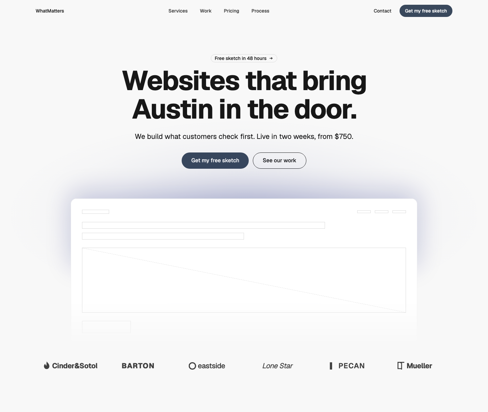
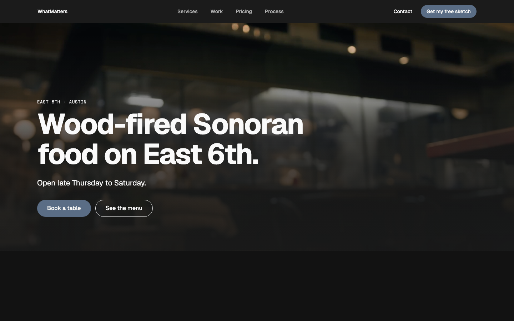
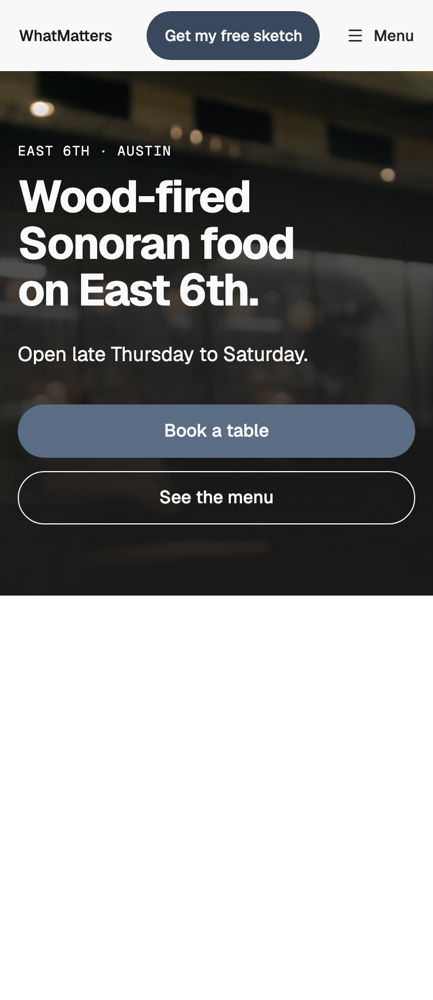

# Hero — Stage

status: approved

One hero for two jobs (Randy, 2026-10-30). It replaced **Hero — Feature Center** and **Hero — Over Media** (approved 2026-11-01).
**File:** `HeroStage.tsx` (copy it). **Example:** `example.tsx`, in four variants (the gallery's **Variant** control passes `variant` to the example). The backdrop variants use Randy's Envato pick ("Blurred Restaurant Interior With Bartender in Background"), licensed for the private gallery and kept in `gallery/public/local/`, never committed here; without it the hero shows the dark page colour under the scrim.

Two choices make the layouts:

- **`backdrop`**: none (the page colour), or a full-width `image` or looping `video` behind the copy under a scrim, in the dark-theme scope.
- **`align`**: the copy at the `start`, `center` or `end`. `end` only over a backdrop, for a photo whose subject sits on the left: on a plain page right-aligned copy is hard to read (every line starts somewhere else), so `end` falls back to `start` there. Phones and tablets are always `start` (a centred headline runs 3–4 lines there, Headings H8).

The framed product window (`visual`, lit from behind) is for a plain page: over a backdrop the picture is the visual, and a window on it turns both murky. With start-aligned copy the window spans the full grid so its edge meets the copy's. The proof row (`logos`) works with or without a backdrop.

| Light | Dark | Mobile (390) |
|---|---|---|
|  |  |  |

## When to use it (Hero R7)

- **Page, centred, with a window and logos:** a product or service with a screen or site to show, and proof under it (was Feature Center).
- **Page, start:** the same, set editorially left.
- **Backdrop, start:** food, places, a room people come to: when the atmosphere is the pitch (was Over Media).
- **Backdrop, centre or end:** the same, when the picture's subject sits on the other side.

For a services business with real work beside the pitch, use **Hero — Split**; for an app, **Hero — Phone Center**.

## Use it

```tsx
import { Button } from "@thewhatmatters/wmds";
import { HeroStage } from "./HeroStage";

<HeroStage
  eyebrow="East 6th · Austin"
  headline="Wood-fired Sonoran food on East 6th."
  lead="Open late Thursday to Saturday."
  actions={
    <>
      <Button role="primary" size="lg" render={<a href="/book" />}>Book a table</Button>
      <Button role="outline" size="lg" render={<a href="/menu" />}>See the menu</Button>
    </>
  }
  backdrop={{ kind: "video", src: "/room.mp4", poster: "/room.jpg", focus: "50% 40%" }}
  // or backdrop={{ kind: "image", media:  }}
  align="start"
/>
```

## Slots and props

| Prop | Kind | Notes |
|---|---|---|
| `nav` | slot, optional | Leave it empty when the page already has a nav. Over a backdrop, give the page's WMDS `SiteNav` `overMedia`: it lays over the picture with no fill and light links, and the hero adds a top fade so they read on bright frames; once you scroll, it's the usual frosted pill (Randy, 2026-11-01) |
| `eyebrow` | ReactNode | Optional. 1–3 words in sentence case, 12px above the headline. Plain `type-eyebrow` unless `eyebrowHref` is set (then one outlined pill link with an arrow, E10) |
| `eyebrowHref` | string, optional | Where the eyebrow links |
| `headline` | ReactNode | The page's only H1: 12 words at most, 2 lines at desktop. WMDS `type-display-1` |
| `lead` | ReactNode | Optional. 1–2 sentences, in ink |
| `actions` | slot | The CTA row, full width and stacked below 640px: one WMDS `<Button role="primary" size="lg">` and at most one `role="outline"` (R2, U7). Over a backdrop the outline's border is the light ink, 3:1 or more |
| `backdrop` | `{ kind: "image", media, focus? }` or `{ kind: "video", src, poster, focus? }`, optional | Leave it out for the page colour. `media` is a decorative `` with width and height, cropped to fill. The video is decorative and part of the design: muted, looping, inline, hidden from assistive tech, playing only while on screen, with no player controls (Randy, 2026-11-06: "for heroes, it doesn't matter"; ux-best-practices Media rule). Under reduced motion it never plays and the poster stays; `poster` is required (it's what shows before the video loads, under reduced motion and in Safari's low-power mode). `focus` keeps a part of the picture in view as it crops |
| `align` | `"start"` \| `"center"` \| `"end"` | Default `center` on a plain page, `start` over a backdrop. From desktop the copy takes 8 columns (2 headline lines): start = 1–8, centre = 3–10, end = 5–12. `end` needs a backdrop |
| `visual` | slot, optional | What goes in the framed window (a product shot, a site). Plain page only; over a backdrop it's left out (with a console warning). Centred copy: columns 2–11; start: the full grid |
| `visualDecorative` | boolean, default `true` | The window is decoration, hidden from screen readers. Set `false` when it carries content people need |
| `logos` | slot, optional | Usually `<HeroStageLogos logos={…} />`: one muted row, 3 per row on phones and 6 from desktop |
| `fullHeight` | boolean, default `false` | Backdrop only: the screen height less 64px, with a scroll cue (R9, R4) |

## Contrast (D8, R5)

Over a backdrop the scrim is the dark page colour: 90% at the bottom, 74% up to 70% of the height, clear at the top (the copy stacks taller on phones, so the scrim reaches higher than Over Media's). Worst pixel behind each part on the example picture; the video measured at 9 frames from 0.5s to 16s (2026-10-30):

| Variant | Headline 1440 / 390 | Eyebrow 1440 / 390 | Outline border 1440 / 390 |
|---|---|---|---|
| Video · start | 8.7 / 4.1 | 13.9 / 14.2 | 15.4 / 14.5 |
| Photo · centre | 8.8 / 4.1 | 10.1 / 14.3 | 15.3 / 14.5 |
| Photo · end | 8.8 / 7.7 | 15.7 / 18.2 | 16.0 / 14.1 |

The headline is display type, so 3:1 is its floor (WCAG 1.4.3 large text); the eyebrow and lead need 4.5:1, the button border 3:1 (1.4.11). For your own footage, check the brightest frame, not the poster; if the headline drops under 3:1, raise the 74% stop.

## Adapt it

The first item is the example the gallery's Copy prompt uses.

- **Restaurant over its room:** `backdrop={{ kind: "video", … }}`, `align="start"`, no `visual` or `logos`.
- **Headline length:** 12 words at most. A 16-word headline runs to 7 lines at desktop and 10 on a phone (Display D6).
- **Product with proof:** no backdrop, `align="center"` (or `"start"`, and the window spans the grid), `visual={<YourScreen />}`, `logos={<HeroStageLogos logos={clients} />}`.
- **Subject on the left of the photo:** `align="end"` with a backdrop, and `focus` to keep the subject in view on phones.
- **Animation:** none beyond the background video, which is still under reduced motion.

## WMDS-GAPs

- **Media component:** no WMDS image or video component with a focal point and a poster under reduced motion; the pattern carries its own small background video until WMDS has one.
- Checked against **@thewhatmatters/wmds 0.4.35** (npm).
