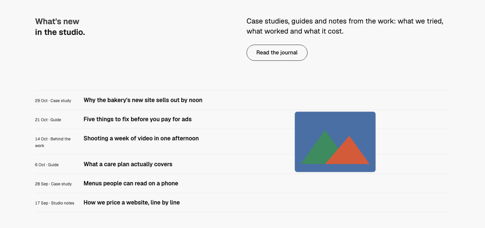
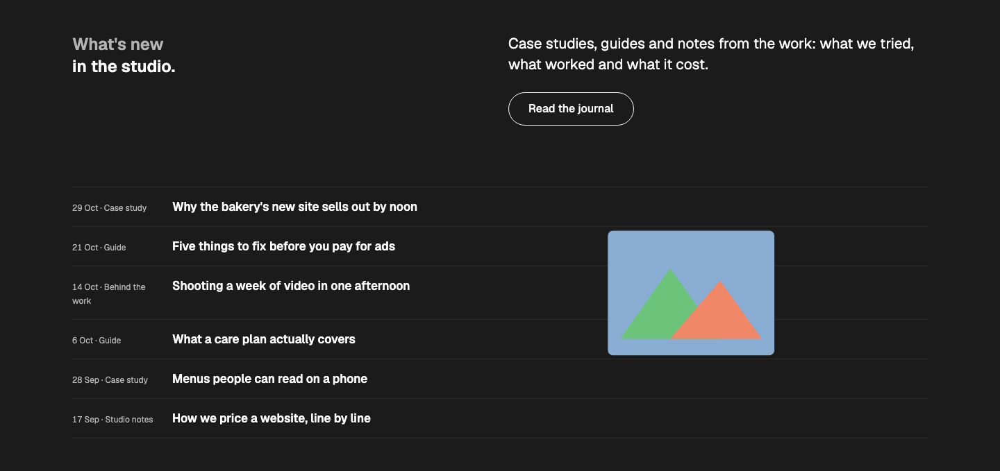
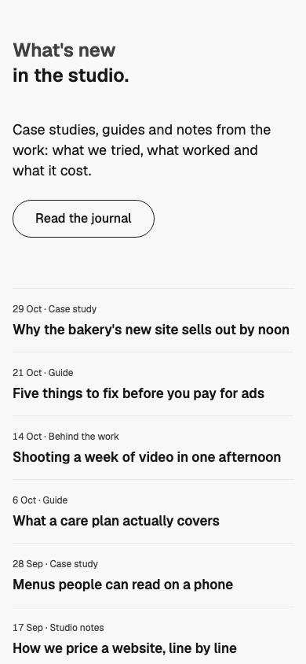

# Journal — Hover Index

status: draft

After United Carriers' "What's moving in your industry" (details.so, https://www.details.so/inspo/unitedcarriers-702f7b), with the two-tone heading from Atlas (Inspiration board). Nothing copied but the idea: the latest posts as a quiet ruled list, and a small cover that follows the mouse over the post it's on.
**File:** `JournalHoverIndex.tsx` (copy it). **Example:** `example.tsx`, six made-up posts with cut-paper SVG covers in WMDS chart colours (licence-free).

A WMDS `Band`: a two-tone heading on the left half (a muted first line, then the rest in ink), an intro and one action on the right half (column 7), then the posts as a WMDS `IndexList`: date and category in the meta column, the title as a link (`h3`, `type-heading-3`). With a mouse, a 240px cover of the post under the pointer trails beside it on a spring.

| Light | Dark (cover showing) | Mobile (390) |
|---|---|---|
|  |  |  |

## Use it

```tsx
import { Button } from "@thewhatmatters/wmds";
import { JournalHoverIndex } from "./JournalHoverIndex";

<JournalHoverIndex
  lead="What's new"
  heading="in the studio."
  actions={<Button role="outline" size="lg" render={<a href="/journal" />}>Read the journal</Button>}
  posts={[
    { title: "Why the bakery's new site sells out by noon", href: "/journal/bakery", meta: <time dateTime="2026-10-29">29 Oct</time>, cover:  },
    // 4–8 posts
  ]}
/>
```

The app needs `motion` (the WMDS peer) installed.

## Slots and props

| Prop | Kind | Notes |
|---|---|---|
| `lead` | ReactNode | The heading's first, quiet part ("What's new"), muted |
| `heading` | ReactNode | The heading's second part ("in the studio."), ink. Both make the section's `h2` |
| `intro` | ReactNode | Optional: one sentence on the right half (`type-lead`) |
| `actions` | slot, optional | One action under the intro: a WMDS outline `<Button size="lg">` to the full journal |
| `posts` | array | 4–8 posts: `title`, `href`, optional `meta` (a `<time>` and a category) and `cover` (slot: an ``, decorative) |
| `tone` | `"default"` (default), `"inverse"`, `"field"` | The WMDS Band tone |

## Motion

- **What:** while a mouse is over a post that has a cover, the cover sits 32px right of the pointer, centred on it, and trails it on a spring (stiffness 260, damping 28). It scales and fades in and out over 180ms; moving to another post swaps the picture in place.
- **How:** Motion `useSpring` on pointer motion values, `AnimatePresence` for in and out. Transform and opacity only; the cover never catches clicks.
- **Who sees it:** only devices with a fine pointer that can hover (`(hover: hover) and (pointer: fine)`), only mouse pointers, never under reduced motion. Touch, keyboard and screen readers get the list alone, which carries everything (the cover is `aria-hidden`).

## Knobs

- `w-60` (cover width), `translate-x-8` (gap from the pointer), the spring values. `size="sm"` on the IndexList (titles two steps under the h2).

## Adapt it

The first item is the example the gallery's Copy prompt uses.

- **Real covers:** pass each post's cover image with `alt=""` (the title already names it); 4:3 crops read best.
- **No covers:** leave `cover` out; the list stands on its own.
- **One-tone heading:** pass the whole heading in `heading` and an empty `lead`.

## Spacing

Full width; Band `md` spacing (48 top and bottom); header → list 40 / 64 (phone / md and up); IndexList rows as WMDS sets them.

## WMDS

Built on **@thewhatmatters/wmds 0.4.45** (npm): `Band`, `IndexList`; the example adds `Button`. Motion **13.5.1** (the WMDS peer).

- **Check change:** `npm run check` has a rule for the new Journal type (one h2, every post title an `h3` link, no h1, no nav).
- **WMDS-GAP: IndexList has no per-row hover hook.** Items take only `className`, so the pattern finds the hovered row from the pointer's target and its position in the list. A follow-cursor preview is a common move (Carousel already has `cursor`); proposed: `IndexList.Item` `media` + an IndexList `followMedia` option that does this inside WMDS, with the same reduced-motion and pointer rules.
