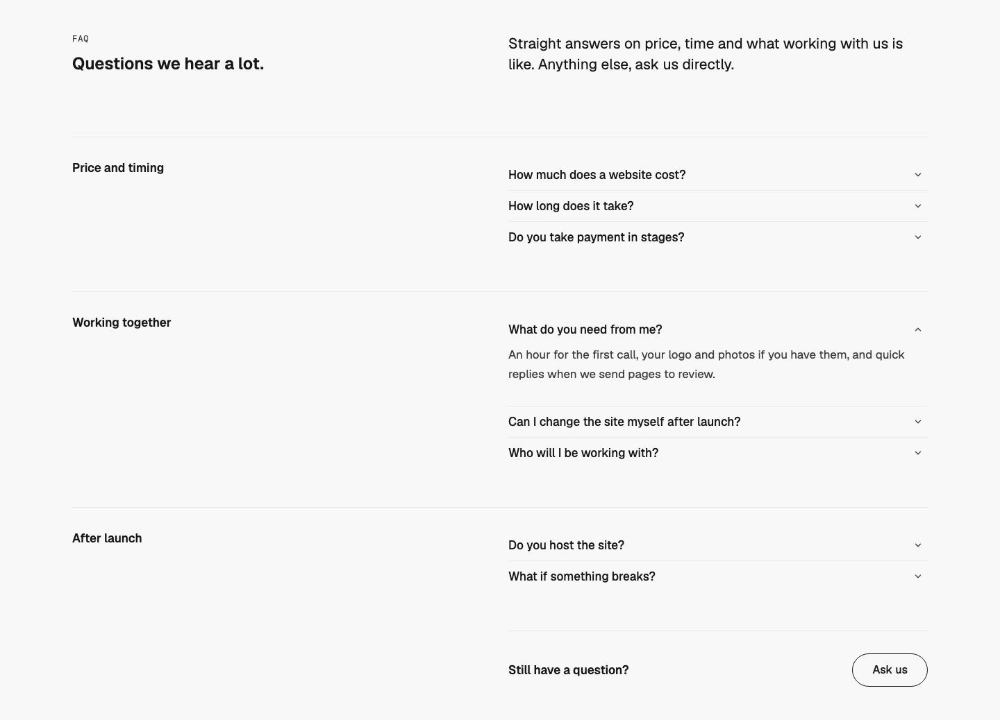
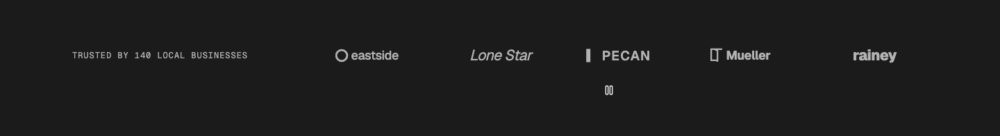
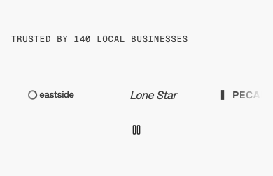

# Logos — Marquee

status: draft

After Interfere's "Trusted and funded by" strip (details.so, https://www.details.so/inspo/interfere-9ec844). Nothing copied but the structure: a short label on the left, the marks drifting past on the right and fading out at both edges.
**File:** `LogosMarquee.tsx` (copy it). **Example:** `example.tsx`, twelve made-up Austin businesses as simple SVG wordmarks in `currentColor` (licence-free stand-ins).

A WMDS `Band` with one row: the label (`h2`, set as a small `type-eyebrow`) on the first columns and the marks on the rest, in a WMDS `Carousel` with `autoplay` and `loop`. The marks drift slowly right to left, forever, and fade at both edges of the row. On phones the label sits above the row.

| Light | Dark | Mobile (390) |
|---|---|---|
|  |  |  |

## Use it

```tsx
import { LogosMarquee } from "./LogosMarquee";

<LogosMarquee
  label="Trusted by 140 local businesses"
  logos={[
    { name: "Barton Bakehouse", logo: <BartonMark /> }, // an <svg> drawn in currentColor
    // 8–16 marks
  ]}
/>
```

## Slots and props

| Prop | Kind | Notes |
|---|---|---|
| `label` | ReactNode | The strip's name, short: "Trusted by", "Clients". It's the section's `h2` and names the row |
| `logos` | array | 8–16 marks: `name` (the company, read by screen readers) and `logo` (slot: a monochrome `<svg>` in `currentColor`) |
| `labelPlacement` | `"inline"` (default) or `"above"` | The label beside the marks (first columns), or on its own line, centred, above them with the marks across the full width (Randy, 2026-11-05) |
| `speed` | number, default `32` | Drift in px a second |
| `tone` | `"default"` (default), `"inverse"`, `"field"` | The WMDS Band tone |

## Motion

- **What:** the row drifts right to left at 32px a second and wraps seamlessly (WMDS Carousel `loop`: a copy follows the last mark).
- **When it stops:** under a pointer, while anything in the row has focus, during a drag, while the row is off screen or the tab is hidden, and always under reduced motion. No visible control (Randy, 2026-11-05): the WMDS Pause button is out of sight until a keyboard user tabs to it (`autoplay.pause: "on-focus"`), and then stops it for good (Logo strip O5, WCAG 2.2.2).
- **Hands on:** the row can also be dragged or scrolled sideways, like any WMDS Carousel.

## Knobs

- `speed`; `itemWidth` on the Carousel (a third of the row on phones, a quarter on tablet, a sixth on desktop); mark height `h-6` / `md:h-8` in the cell.
- Marks take `text-muted`; brands change it through WMDS colour knobs.

## Adapt it

The first item is the example the gallery's Copy prompt uses.

- **Your clients' real marks:** monochrome SVGs in `currentColor`, with permission, and the company name in `name`.
- **On the brand's dark surface:** `tone="inverse"`.
- **Still, no drift:** use Hero — Stage's `HeroStageLogos` row instead (a marquee that never moves is just a scroller).

## Spacing

Full width; Band `md` spacing (48 top and bottom); label above the row with 16 between on phones; each mark in a 64px-tall cell.

## WMDS

Built on **@thewhatmatters/wmds** with `Carousel` `autoplay.pause: "on-focus"` (WMDS branch `lead-engineer/carousel-pause-on-focus`, after 0.4.45; the pin bump follows its release): `Band`, `Carousel` (`autoplay`, `loop`, `fade`). No Motion import, no new library.

- **Check change:** `npm run check` has a rule for the new Logos type (one h2, no h1, no nav, every mark with its company name as text). The existing Logo strip O4/O5 checks run on it too.
- **WMDS-GAP (bug): Carousel `loop` widens the page.** The looped copies spill about 4,200px past the row (measured at 1440: the document scrolled sideways to 4,638px). The pattern clips its own row cell (`overflow-x-clip`) so the page stays 1,440 / 390 wide; WMDS should contain its loop inside the Carousel.
- **WMDS-GAP: Carousel loop needs enough items.** With fewer marks than fill the row, the loop shows a gap. WMDS could repeat the set until it fills the row (a `minRepeat` or automatic fill), so a client with six logos can still use a marquee.
