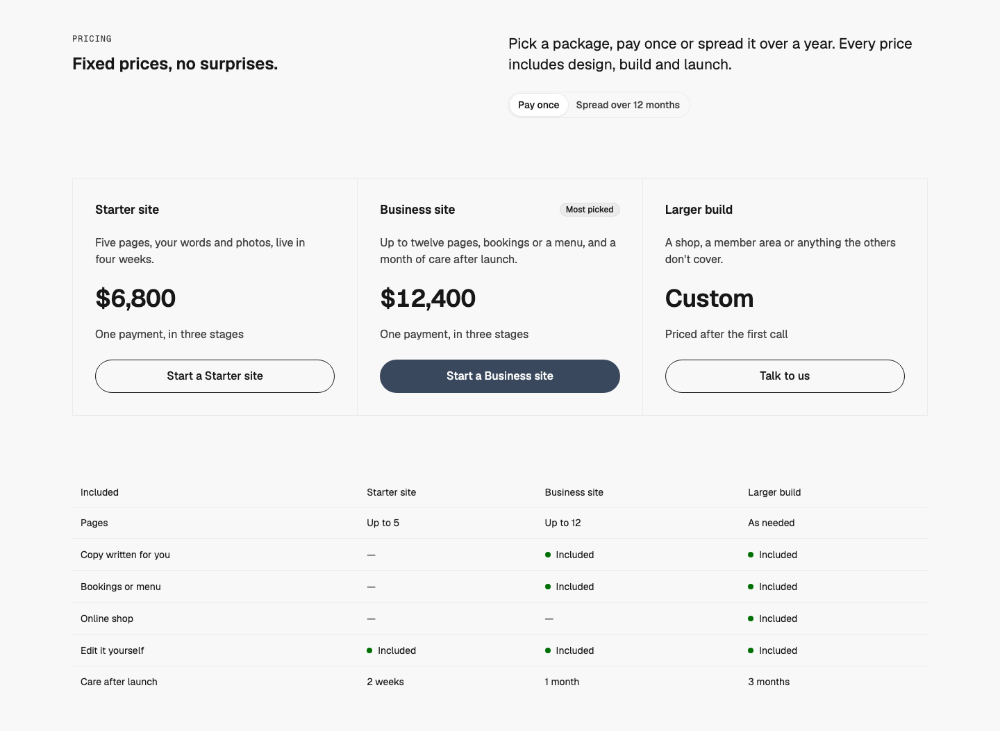
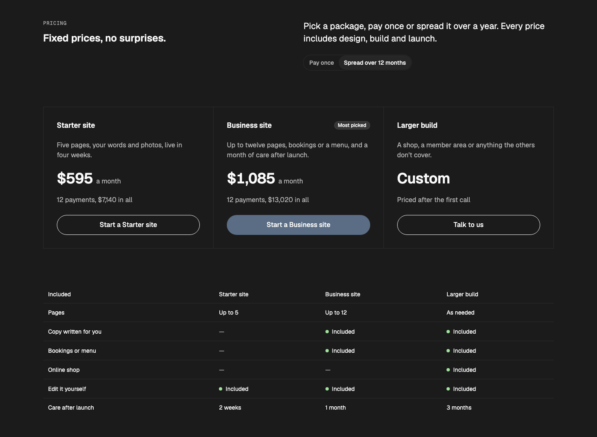
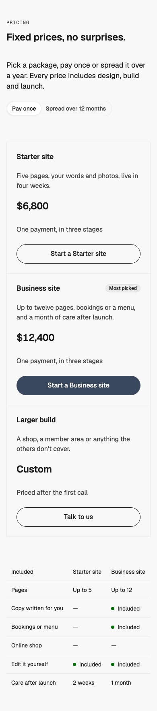

# Pricing — Ruled Table

status: draft

After Heron AI's pricing (Inspiration board #9; details.so, https://www.details.so/inspo/heronaiapp-eddac6). Nothing copied but the structure: packages in ruled cells, a billing toggle above them, and a comparison table under them.
**File:** `PricingRuledTable.tsx` (copy it). **Example:** `example.tsx`, a studio's three website packages (made-up prices and features).

Built for service businesses that sell fixed-price packages, not subscriptions: the toggle switches between **Pay once** and **Spread over 12 months** (the price spread across the months, plus a small fee), and each price slides to its new figure. Heading on the left half; intro and toggle on the right half (column 7). The packages sit in ruled cells that share their rules: name (`h3`), an optional badge ("Most picked"), one line on who it's for, the price, how it's paid, and the CTA. A WMDS `Table` under them compares what each includes.

| Light | Dark (monthly) | Mobile (390) |
|---|---|---|
|  |  |  |

## Use it

```tsx
import { Button } from "@thewhatmatters/wmds";
import { PricingRuledTable } from "./PricingRuledTable";

<PricingRuledTable
  heading="Fixed prices, no surprises."
  tiers={[
    { name: "Starter site", description: "Five pages…", price: 6800, action: <Button role="outline" size="lg" render={<a href="/start" />}>Start a Starter site</Button> },
    { name: "Larger build", description: "A shop…", price: null, action: <Button role="outline" size="lg" render={<a href="/talk" />}>Talk to us</Button> },
  ]}
  rows={[{ feature: "Pages", values: ["Up to 5", "As needed"] }]}
/>
```

The app needs `motion` (the WMDS peer) installed.

## Slots and props

| Prop | Kind | Notes |
|---|---|---|
| `heading` | ReactNode | The section's `h2`, one short line (WMDS `type-heading-1`) |
| `eyebrow` | ReactNode | Optional: a short label above the heading |
| `intro` | ReactNode | Optional: one sentence on the right half (`type-lead`) |
| `tiers` | array | 2–4 packages: `name` (an `h3`), `description`, `price` (a number, or `null` for "Custom"), `action` (slot: a WMDS `<Button size="lg">`, primary on the picked one, outline on the rest), optional `badge` |
| `rows` | array, optional | Comparison rows: `feature` and one value per tier: `true`, `false` or short text |
| `months` | number, default `12` | How many months the monthly option spreads the price over |
| `monthlyFee` | number, default `0.05` | Added when the price is spread (0.05 = 5%) |
| `currency` | string, default `"USD"` | ISO currency, formatted with `Intl.NumberFormat` |
| `tone` | `"default"` (default), `"inverse"`, `"field"` | The WMDS Band tone |

## Motion and behaviour

- **Toggle:** WMDS `SegmentedControl` ("How you pay"). The prices sit in a polite live region, so a screen reader hears the new figure.
- **Price change:** the old price slides up and out, the new one slides up into place, 200ms, ease-out (Motion `AnimatePresence` + `motion.span`, transform and opacity). Under reduced motion they simply swap.
- **Comparison:** WMDS `Table`: row headers (`th scope="row"`), the feature column pinned while the table scrolls sideways on phones. Included is a WMDS `Status` dot plus the word "Included"; not included is a dash with "Not included" for screen readers.

## Knobs

- `months`, `monthlyFee`, `currency`. The price uses WMDS `type-display-3`; the cells `p-6` / `lg:p-8`.
- Tier columns: 2 → 2 across, 3 → 3 across, 4 → 2 then 4 across (from md / lg).

## Adapt it

The first item is the example the gallery's Copy prompt uses.

- **Your packages:** two to four, each with a real price and one line on who it's for; put the one most people pick in the middle with the badge and the primary button.
- **No monthly option:** remove the `SegmentedControl` in your copy and keep `plan` at "once".
- **No comparison:** leave `rows` out when the descriptions say enough.

## Spacing

Full width; Band `md` spacing (48 top and bottom); header → packages 40 / 64 (phone / md and up); cell padding 24 / 32; 24 between parts in a cell; packages → table 40 / 64.

## WMDS

Built on **@thewhatmatters/wmds 0.4.45** (npm): `Band`, `SegmentedControl`, `Badge`, `Status`, `Table`; the example adds `Button`. Motion **13.5.1** (the WMDS peer).

- **Check change:** `npm run check` has a rule for the new Pricing type: one h2, an h3 per package, no h1, no nav, every package's action a link, and the comparison (when present) with row headers.
- **WMDS-GAP: no check mark.** WMDS has no check glyph for "included" (patterns can't import lucide). The pattern uses a WMDS `Status` dot plus the word; Heron uses a ticked box. Proposed: a `Status` `variant="check"` or a small WMDS `CheckMark`.
- **WMDS-GAP: Table columns can't line up with the cells above.** The comparison's columns size to their content, so they don't sit under the package cells. Proposed: a `Table` `columns` prop (fixed widths or `grid-page` spans).
- **WMDS-GAP: primary Button on dark reads muted.** The same open gap as the dark-section patterns (per-tone primary).
