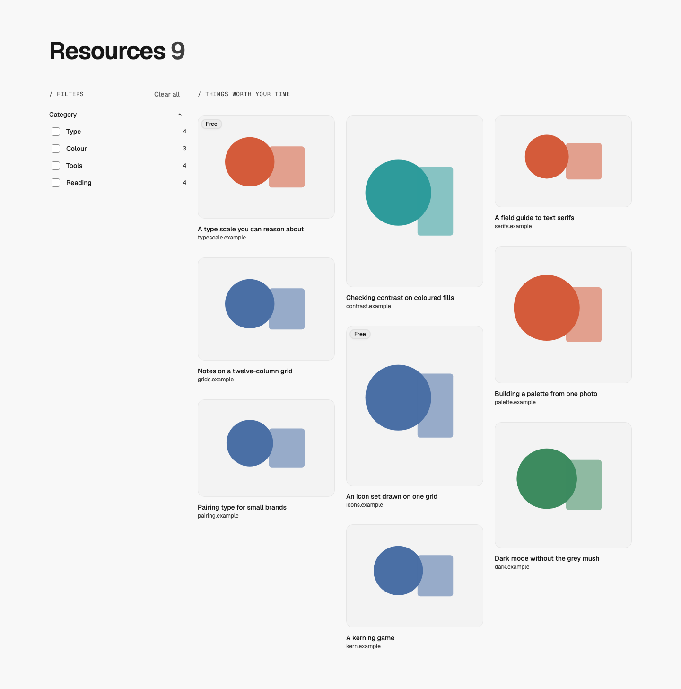
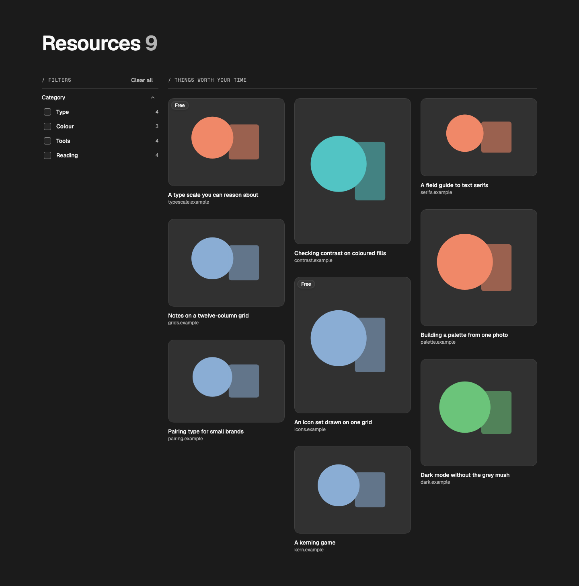
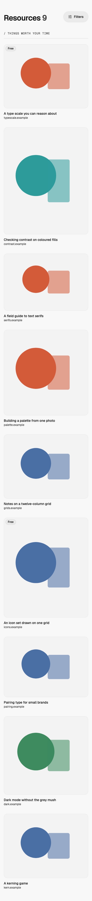

# Resources — Filtered Grid

status: approved

Taken from whatmatters.so/resources (Randy, 2026-11-07: "I like how the blog and resources pages are already set up. I like that style."). The site pastes WMDS's Storybook "Pattern — filtered grid"; this is that page as a wmds-patterns pattern, with every word a prop.
**File:** `ResourcesFilteredGrid.tsx` (copy it). **Example:** `example.tsx`, nine made-up resources with SVG stand-in previews in WMDS chart colours (licence-free).

The page's `main` on the WMDS page grid: the h1 with the count of shown resources, a WMDS `FilterPanel` rail on the first three columns from md (a Filters button and a sheet on phones), a WMDS `SectionCaption` that names the grid, and a WMDS `TileGrid` of `LinkTile`s: the preview, an optional tag over it ("Free"), the title and one line (the domain). Masonry by default, so each preview keeps its own shape; `uniform` crops them all to 4:3. Six placeholder tiles while `loading`.

| Light | Dark | Mobile (390) |
|---|---|---|
|  |  |  |

## Use it

```tsx
import Image from "next/image";
import Link from "next/link";
import { ResourcesFilteredGrid } from "./ResourcesFilteredGrid";

<ResourcesFilteredGrid
  title="Resources"
  caption="Things worth your time"
  groups={[{ id: "category", label: "Category", options: [{ value: "type", label: "Type" }] }]}
  items={[
    { id: "type-scale", title: "A type scale you can reason about", href: "/resources/type-scale", meta: "typescale.com", tag: "Free",
      image: { src: "/resources/type-scale.png", alt: "The type scale tool", width: 1200, height: 900 }, facets: { category: ["type"] } },
  ]}
  renderLink={(item) => <Link href={item.href} scroll={false} />}
  renderImage={(image) => <Image {...image} sizes="(min-width: 1024px) 25vw, (min-width: 640px) 50vw, 100vw" />}
/>
```

## Slots and props

| Prop | Kind | Notes |
|---|---|---|
| `title` | ReactNode | The page's only h1, WMDS `type-display-2`; the count follows it |
| `caption` | string | Names the grid (WMDS `SectionCaption`), sentence case |
| `items` | `Resource[]` | `id`, `title`, `href`, `external?`, `image` (`src`, `alt`, `width`, `height`), `meta?`, `tag?`, `facets`. Newest first |
| `groups` | `FilterPanelGroup[]` | Filter groups; counts come from the items |
| `layout` | `"masonry" \| "uniform"`, default `masonry` | Keep each preview's shape, or crop all to 4:3 |
| `columns` | `TileGridColumns`, optional | Default 1 / 2 from sm / 3 from lg |
| `loading` | boolean | Six placeholder tiles, and "Loading resources" read out |
| `defaultSelection`, `selection` / `onSelectionChange` | optional | Filters from the address, or held by your app |
| `renderLink` | function, optional | Your router's link for a tile (not used for `external` items) |
| `renderImage` | function, optional | Your image component; a plain lazy `img` otherwise |
| `overlay` | slot, optional | Page-level layers inside the grid |
| `labels` | object, optional | `count`, `filters`, `clear`, `show`, `loading`, `empty`, `noMatch` |

## Adapt it

The first item is the example the gallery's Copy prompt uses.

- **Your resources:** one content file each (title, link, category, preview); read the preview's real width and height so the masonry holds its space.
- **Open over the grid:** link each tile to the resource's own page and render that page in a dialog over the grid (Next parallel routes), so Back returns to the same scroll.
- **Same-shape previews:** `layout="uniform"`.
- **Animation:** none by default.

## Spacing

Page padding 24 / 40 / 56; title row → grid 16 / 32; caption → tiles 24. Rail 3 columns from md; the grid takes 5 of 8 on tablet, 9 of 12 on desktop.
