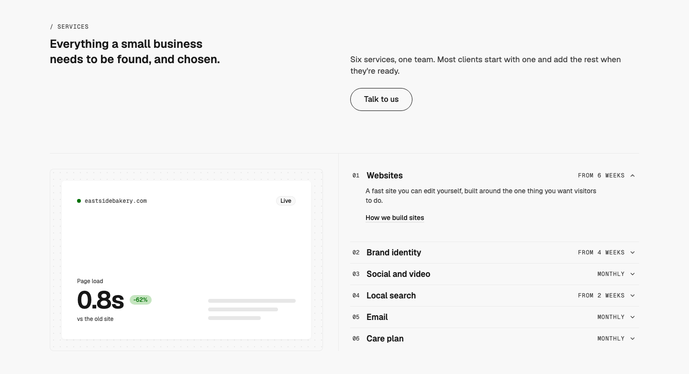
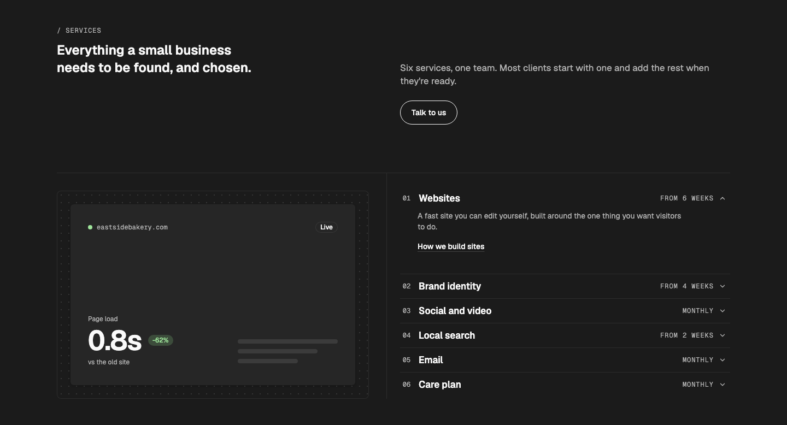
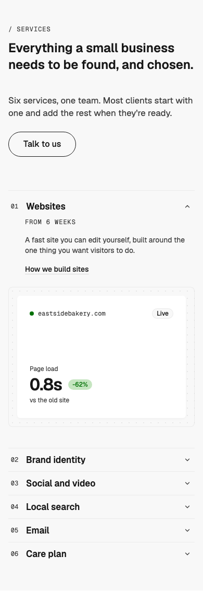

# Services — Split Index

status: approved

After Heron AI's services section, "Built to work the way you do" (Inspiration board #9; also on details.so, https://www.details.so/inspo/heronaiapp-90cbbe). Nothing copied but the structure: a ruled split with the services listed on one side and the open one's picture on the other.
**File:** `ServicesSplitIndex.tsx` (copy it). **Example:** `example.tsx`, whose pictures are small WMDS compositions of each service's output (licence-free; swap in real work).

A small mono caption, a heading with a short intro and one CTA beside it, then two cells under a hairline: the open service's picture in a dot-grid frame on the left, which stays in view while the list scrolls, and the services as a numbered WMDS `Accordion` on the right. One service is open at a time; opening another swaps the picture. On phones the frame drops away and each picture sits inside its own open row.

| Light | Dark | Mobile (390) |
|---|---|---|
|  |  |  |

## Use it

```tsx
import { TextLink } from "@thewhatmatters/wmds";
import { ServicesSplitIndex } from "./ServicesSplitIndex";

<ServicesSplitIndex
  heading="Everything a small business needs to be found, and chosen."
  intro="Four services, one team."
  services={[
    { title: "Websites", meta: "From 6 weeks", description: "A fast site you can edit yourself.", link: <TextLink href="/websites">How we build sites</TextLink>, visual:  },
    // …
  ]}
/>
```

## Slots and props

| Prop | Kind | Notes |
|---|---|---|
| `heading` | ReactNode | The section's `h2`, one or two lines (WMDS `type-display-3`) |
| `intro` | ReactNode | Optional: a sentence or two beside the heading, muted |
| `caption` | slot, optional | The small mono caption over the section (WMDS `SectionCaption`). Default "Services" |
| `actions` | slot, optional | One CTA under the intro, usually a WMDS `<Button role="outline" size="lg">` |
| `services` | array | 3–6 services: `title`, `description`, `visual` (slot), optional `meta` (short, e.g. "Monthly"; hidden under 640px) and `link` (a WMDS `<TextLink>`) |
| `defaultIndex` | number, default `0` | The service open at first |

## Behaviour

- **Rows** are WMDS `Accordion` (plain, flush): buttons with `aria-expanded`, keyboard and focus from WMDS. Opening a row closes the others; closing the open row leaves the frame on its picture.
- **The frame** is `position: sticky` (top 32px), 3:2, on the WMDS dot-grid background. With 5–6 services the list and the frame end at about the same height (in the example, within 4px at 1440); with 3–4 the list is shorter and the frame sits still. Every service's `visual` is stacked inside; only the shown one is visible, and the hidden ones are `inert` and `aria-hidden`, so a picture that carries meaning needs its own `alt` or `aria-label`.
- **Pictures fill the frame** (a 16–24px inset). Set each on one plain surface; don't put bordered cards inside the frame, or it reads as a widget in a widget. A picture must fit its frame at 320px wide (the tablet frame) without clipping.
- **Frame shape:** square on tablet; on desktop 3:2 with 5–6 services and 16:9 with 3–4, so the list and frame end close together either way.
- **Titles:** keep them to about 22 characters. WMDS Accordion sets the label on one line and cuts a longer one with an ellipsis. Meta ("From 6 weeks") hides in the row on phones and is repeated at the top of the open panel.
- **Each picture renders twice** (in the frame and in its phone row). Fine for SVG and small images; for a video, load it lazily or pass a poster on phones.
- **Phones (< 768px):** the frame is hidden and the open row shows its picture under the description, at full content width and 4:3. 4:3 is a minimum: a taller picture (a stat list on a 320px phone) grows the frame instead of being cropped. Pictures with figures are content (P1), so they always show.
- **Motion:** the Accordion's own open and close, plus a **150ms ease-out crossfade** when the shown picture changes (CSS opacity, so the outgoing and incoming pictures overlap). Under `prefers-reduced-motion` the picture swaps with no fade. This is the one place the pattern animates beyond WMDS, by Randy's call (2026-10-28).

## Knobs

- `--text-display-3-size` (heading), WMDS `type-heading-3` (row titles).
- Rules and the frame use `border-border`; the frame fill is `wmds-pattern-dot-grid` on the page background.

## Adapt it

The first item is the example the gallery's Copy prompt uses.

- **Real work as pictures:** pass an `` or `<video>` per service (fill the frame: `className="size-full object-cover"` and drop the frame's padding in your copy).
- **No CTA:** leave `actions` empty.
- **Picture on the right:** swap the two cells' order and move the centre rule (`border-r` → `border-l` on the frame cell, `md:pl-8` → `md:pr-8` on the list).
- **More services:** five or six balance the frame best; past six, use a plain list or split into two sections.

## Spacing

Full width; section padding 48 top and bottom (WMDS Band `md`, Spacing S8); caption→heading 24; header→cells 40 / 64; 32 each side of the centre rule.

## WMDS

Built on **@thewhatmatters/wmds 0.4.28** (npm): `SectionCaption`, `Accordion`, `backgroundPatternDotGridClasses`; the example adds `Status`, `Badge`, `ChartRankedBars`, `TextLink`, `Button`.

- **WMDS bug: `ChartRankedBars` without `max` draws every bar at 100%.** The example passes `max`; fix in WMDS.
- **WMDS-GAP: Accordion labels don't wrap.** A long service name is cut with an ellipsis in the fixed-height row. Proposed: an `Accordion.Item` wrapping-label option.
- **WMDS-GAP: no plain big figure.** `Stat` always draws its own bordered box, which nests inside the frame; the example sets figures with `type-display-2` and a `Badge`. Proposed: `Stat` `surface="none"`.

- **WMDS-GAP: no selected-row emphasis.** Heron marks the open service with an inverted ink band across the row; WMDS `Accordion` has no selected or inverse state for an item, and a pattern can't restyle it (its `className` is layout-only). Left out rather than patched. Proposed: `Accordion.Item` `emphasis="inverse"` when open (the `data-tone="inverse"` remap Band already uses).
- **WMDS-GAP: no large index size for Accordion.** Rows are fixed at `h-11`; the pattern sets the title in `type-heading-3` inside the label slot, which fits but leaves no room for a bigger index (IndexList has `size="lg"`, but no single-open preview with a linked picture). Proposed: `Accordion` `size="lg"` for editorial lists.

## Grid

On the WMDS page grid at every width: the heading spans the frame's columns (1–4 on tablet, 1–6 on desktop); the intro and CTA start on the list's first column (5 on tablet, 7 on desktop), so the header lines up with the split; the split itself is a `grid-cols-subgrid` of the page columns. Randy (2026-10-28) approved it after the intro moved off column 9, where it floated right of everything (and overflowed the 8-column tablet grid).
