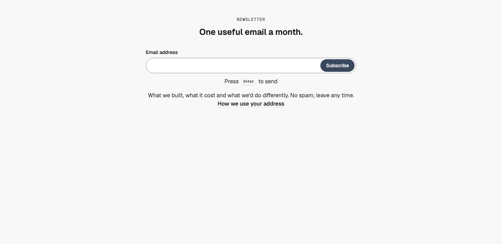
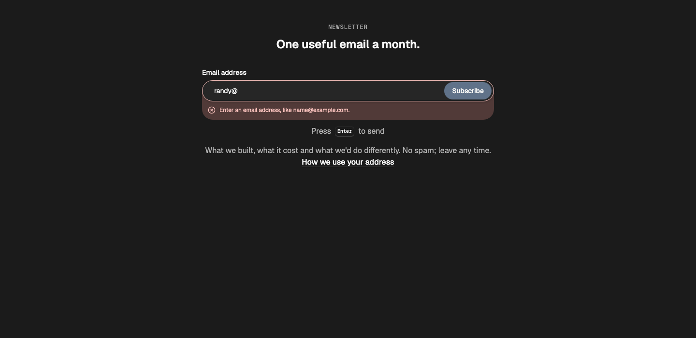
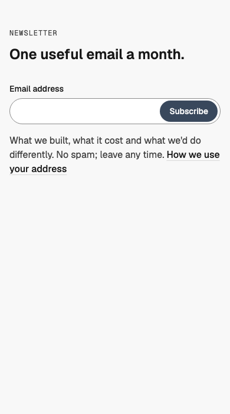

# Signup — Inline Field

status: draft

Needs WMDS 0.4.50 or later (Search `actionType`, `status` and `message`).

After Plnty's "Join early & claim" (details.so, https://www.details.so/inspo/plnty-217df2). Nothing copied but the structure: one big line, one email field you send with Enter, and a short line under it about what you'll get.
**File:** `SignupInlineField.tsx` (copy it). **Example:** `example.tsx`, a studio's monthly newsletter that pretends to store the address (nothing is sent).

A WMDS `Band`: eyebrow and heading, then a form with a labelled email field whose **Subscribe** button sits inside it at the right end (WMDS `Field` + `Search` with `actionType="submit"`, Randy 2026-11-09), on phones too, a "Press Enter to send" hint with a WMDS `Kbd` (pointer devices), and a note on what people get. Left-aligned on phones; centred on the middle six columns from lg (Grid rule). Plain and content-led: the only change on screen is the form's own state.

| Light | Dark (invalid address) | Mobile (390) |
|---|---|---|
|  |  |  |

## Use it

```tsx
import { SignupInlineField } from "./SignupInlineField";

<SignupInlineField
  heading="One useful email a month."
  note="What we built, what it cost and what we'd do differently. No spam; leave any time."
  onSubscribe={async (email) => {
    const response = await fetch("/api/subscribe", { method: "POST", body: JSON.stringify({ email }) });
    if (!response.ok) throw new Error("That didn't go through. Try again in a moment.");
  }}
/>
```

## Slots and props

| Prop | Kind | Notes |
|---|---|---|
| `heading` | ReactNode | The section's `h2`: what they're signing up for, short (WMDS `type-heading-1`) |
| `eyebrow` | ReactNode | Optional: a short label above the heading ("Newsletter") |
| `note` | ReactNode | Optional: what they get and how often, under the form; may hold a privacy `TextLink` |
| `doneMessage` | ReactNode | Shown in place of the form once it's stored. Default "You're in. Check your inbox to confirm." |
| `submitLabel` | string, default `"Subscribe"` | The button, a verb ("Join the waitlist") |
| `onSubscribe` | `(email) => Promise<void>` | Stores the address. Resolve when stored; throw an `Error` whose message is shown under the field |
| `tone` | `"default"` (default), `"inverse"`, `"field"` | The WMDS Band tone |

## Behaviour

- **Form:** a real `<form>`; Enter or the button sends. The field has a visible label ("Email address"), `type="email"`, `autocomplete="email"` and is required; no placeholder (form rules).
- **States:** an address that doesn't look like an email shows "Enter an email address, like name@example.com." in the WMDS Input's error band before anything is sent. While sending, the WMDS Button shows its loading state ("Sending…") and the field is disabled. A thrown error shows its message in the same band and keeps the address; success replaces the form with `doneMessage` (a polite status).
- **Layout:** from md the button drops by the label's height so it stays level with the field when the error band opens under it.
- **Motion:** only the WMDS Button's own state change.

## Knobs

- `lg:col-span-6 lg:col-start-4` (the centred measure), `size="lg"` on the field and button.

## Adapt it

The first item is the example the gallery's Copy prompt uses.

- **Wire it up:** replace `pretendSubscribe` with your list's endpoint (Buttondown, Mailchimp, ConvertKit, your own); keep the thrown-message contract.
- **Waitlist:** `submitLabel="Join the waitlist"` and a `doneMessage` that says when they'll hear back.
- **On the brand's dark surface:** `tone="inverse"` for a closing section.

## Spacing

Full width; Band `md` spacing (48 top and bottom); eyebrow → heading 12; heading → form 32; form → hint 12; → note 16.

## WMDS

Built on **@thewhatmatters/wmds 0.4.50** (npm): `Band`, `Field`, `Search` (`actionType="submit"`, `status`, `message`, new in 0.4.50), `Kbd`; the example adds `TextLink`. No Motion, no new library.

- **Check change:** `npm run check` has a rule for the new Signup type: one h2, no h1, no nav, a real form with a labelled email field and a submit button. The existing form rules (no placeholder; a one-field form's field is required) run on it too.
- **WMDS-GAP: no display-size input.** Plnty's field is oversized, the moment of the section; WMDS `Input` tops out at `lg` (48px). Proposed: `Input` `size="xl"` (display type, taller) for single-field moments like this, with Button to match.
