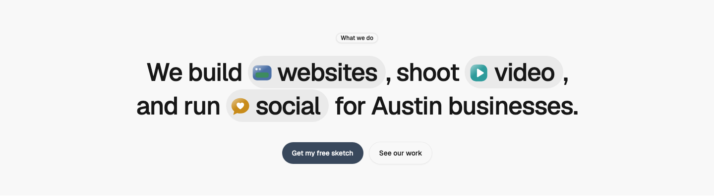
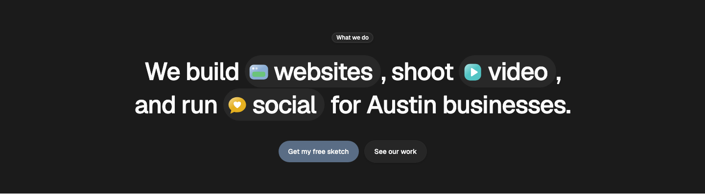
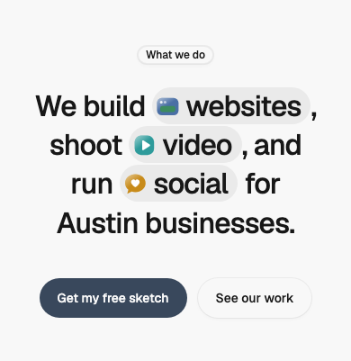

# Statement — Inline Pills

status: draft

After the inline icon chips in Graphical's hero sentence (Inspiration board; Randy's reference, 2026-10-27). Nothing copied but the idea.
**File:** `StatementInlinePills.tsx` (copy it; it holds `StatementInlinePills` and `InlinePill`). **Example:** `example.tsx`, with simple glossy SVG icons drawn in WMDS chart colours (licence-free stand-ins).

One big centred sentence whose key words sit in soft pills, each with a small picture on its left. When the sentence scrolls into view, the pictures pop in one after another with a small tilt and overshoot. Playful, and it works with nothing but type and three icons.

The first **statement** pattern: a full-width section built around one sentence. Use it under the hero as an intro or "what we do" line, or as the hero itself (`as="h1"`).

| Light | Dark | Mobile (390) |
|---|---|---|
|  |  |  |

## Use it

```tsx
import { Button } from "@thewhatmatters/wmds";
import { InlinePill, StatementInlinePills } from "./StatementInlinePills";

<StatementInlinePills animate actions={<Button role="primary" render={<a href="/start" />}>Start</Button>}>
  We build <InlinePill media={}>websites</InlinePill>, shoot{" "}
  <InlinePill media={}>video</InlinePill>, and run{" "}
  <InlinePill media={}>social</InlinePill> for Austin businesses.
</StatementInlinePills>
```

## Slots and props

| Prop | Kind | Notes |
|---|---|---|
| `children` | slot | The sentence: about 10–18 words, with 2–4 key words wrapped in `<InlinePill>`. Keep punctuation outside the pills. WMDS `type-display-2`, about 18em wide, so it sets in 2–3 lines |
| `eyebrow` | slot, optional | A short line above the sentence, usually a WMDS `<Badge>` |
| `actions` | slot, optional | The CTA row under the sentence: one or two WMDS `<Button>`s |
| `as` | `"h2"` (default) or `"h1"` | `h1` when the statement is the page's hero; `h2` anywhere else |
| `animate` | boolean, default `false` | Pop the pills' pictures in when the sentence is 40% in view, once. Skipped under `prefers-reduced-motion` |

`InlinePill`: `media` (the picture: an ``, a 3D render or an SVG; it's decorative, the word carries the meaning) and `children` (the word or words). Pills are sized in em, so they scale with the sentence at every breakpoint.

## Motion

- **What:** each picture scales from 0 with a -24° tilt to 1.14 and 6°, then settles at 1 and 0°; pictures follow each other one WMDS beat apart (`--motion-beat`, 160ms), over `--duration-medium-max` (550ms) on `--ease-standard`.
- **How:** the Web Animations API (`element.animate`), no library, transform and opacity only. The pictures are hidden before the first paint, so they never flash in and then animate. Runs once.
- **Hover:** a picture tilts a little (-8°) when its pill is hovered, where motion is allowed.
- **Reduced motion:** no pop-in and no tilt; the pictures are simply there.
- **With Motion (motion.dev) in your app:** swap the hook for `whileInView` on each picture with the same keyframes and a `staggerChildren` of 0.16.

## Knobs

- `--text-display-2-size`: the sentence uses WMDS `type-display-2`.
- The pill's fill is the text colour (`--color-fg`) at 6%, so it shows on any background and in both themes.
- The pill's shape is in `pillClasses` (em-based padding, fully round); the picture is 0.9em square in `mediaClasses`.

## Adapt it

The first item is the example the gallery's Copy prompt uses.

- **Different sentence:** change the words and the pills; keep it to 2–3 lines and 2–4 pills.
- **Real icons:** pass `` with transparent PNG or SVG icons, or small 3D renders (Envato 3D has glossy icon sets); keep them square.
- **As the hero:** set `as="h1"`, and put the page's CTAs in `actions`.
- **No animation:** leave `animate` off; the pills are still the moment.
- **Left-aligned:** change `items-center text-center` in `innerClasses` to `items-start text-left`.

## Spacing

Full width; section padding 48 / 64 top and bottom (phone / tablet and up); eyebrow→sentence 24; sentence→CTAs 40.

## WMDS-GAPs

- **Inline headline pill.** WMDS `Chip` and `Badge` are UI-sized (sm / md / lg, fixed px) and take only Lucide icons, so neither can sit inside a display-size sentence with a picture. The pattern carries `InlinePill` until WMDS has an em-sized inline pill with a media slot.
- **Scroll-triggered pop-in.** WMDS has `BlurReveal` and `TextSequence`, but nothing that pops in parts of a sentence; the pattern's small hook does it.
- Checked against **@thewhatmatters/wmds 0.4.27** (npm).
