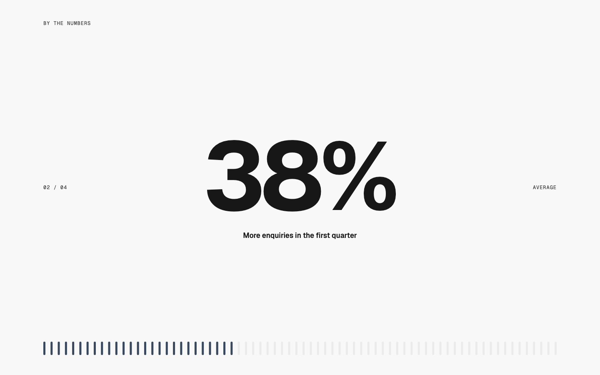
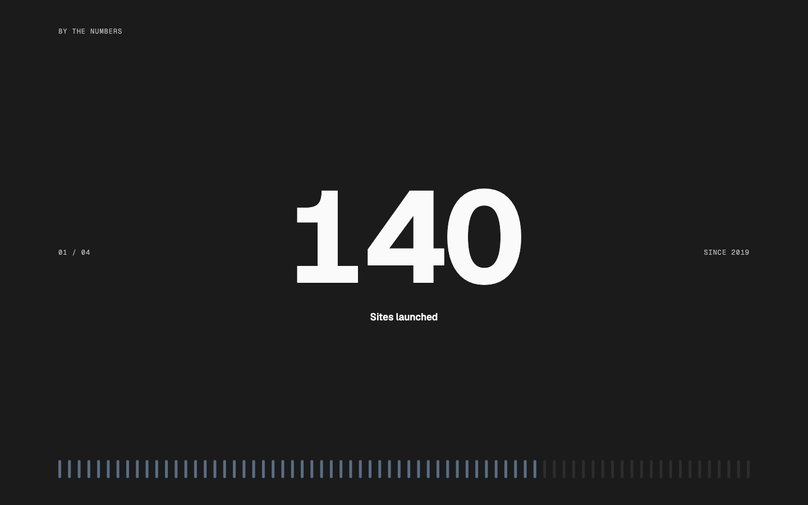
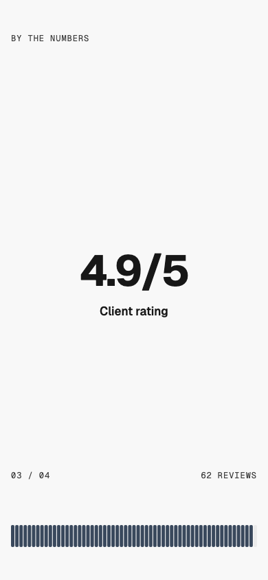

# Stats — Pinned Counter

status: draft

After CoMinVi's pinned stats dial (details.so, https://www.details.so/inspo/cominvi-8bbec0). Nothing copied but the idea: the section pins, and each key figure gets the whole screen in turn, a huge number with a row of ticks lit up to it. CoMinVi's ticks run round a large dial; here they run in a straight WMDS meter across the page, because WMDS's ring can't be that big yet (see WMDS).
**File:** `StatsPinnedCounter.tsx` (copy it). **Example:** `example.tsx`, a studio's four figures (made up).

The section takes one screen of scroll per figure. On the pinned screen: the heading as a small label top-left, the figure in the middle (WMDS `type-display-hero`) with its label under it, a mono "02 / 04" and the figure's category at the sides, and a WMDS `Chart.SegmentedBar` of 72 tall ticks along the bottom that fills to the figure as you scroll into it.

| Light | Dark | Mobile (390) |
|---|---|---|
|  |  |  |

The screenshots are single moments of the scroll; frames are in the night's report.

## Use it

```tsx
import { StatsPinnedCounter } from "./StatsPinnedCounter";

<StatsPinnedCounter
  heading="By the numbers"
  stats={[
    { value: 140, max: 200, label: "Sites launched", category: "Since 2019" },
    { value: 38, suffix: "%", label: "More enquiries in the first quarter", category: "Average" },
    // 3–5 figures
  ]}
/>
```

The app needs `motion` (the WMDS peer) installed.

## Slots and props

| Prop | Kind | Notes |
|---|---|---|
| `heading` | ReactNode | The section's `h2`, short, set as a small label at the top of the pinned screen |
| `stats` | array | 3–5 figures: `value`, `label` (what it counts), optional `category` (side label), `prefix`, `suffix`, `decimals`, `max` (a full meter; default 100) |
| `tone` | `"default"` (default), `"inverse"`, `"field"` | The WMDS Band tone |

## Motion

- **Scroll:** one screen of scroll per figure; the screen stays pinned (CSS `position: sticky`) for the whole section. Scroll position (Motion `useScroll`) picks the figure, and the meter fills to it over the first 40% of the figure's stretch, then holds.
- **Number:** counts from the last figure to the new one over 0.8s, easing out (`animate` on a Motion value, rendered as text through `useTransform`). A tween rather than a spring, so it always lands on the exact figure.
- **Reduced motion:** the number and the meter jump straight to each figure (measured: the right figure 80ms after scrolling).
- **Screen readers:** every figure is in a visually hidden `dl` (label, then figure), so nothing depends on scrolling; the moving figure and the meter are `aria-hidden`.

## Knobs

- `meterHeight` (64px tall ticks) and `segments={72}` on the meter; `tone="primary"` for the lit ticks.
- `0.4` in the scroll handler: how much of each figure's stretch the meter takes to fill. `0.8` and the ease on the count.

## Adapt it

The first item is the example the gallery's Copy prompt uses.

- **Your own figures:** keep 3–5, each with a real source; set `max` so a full meter means something (a goal, the scale's top).
- **On the brand's dark surface:** `tone="inverse"`.
- **Shorter scroll:** change `count * 100` (svh per figure) to `count * 70`.

## Spacing

Full width; the pinned screen has 48px top and bottom (Band `md`); the side labels sit at mid-height from md and 144px above the bottom on phones (just above the meter).

## WMDS

Built on **@thewhatmatters/wmds 0.4.35** (npm): `Band`, `Chart.Frame` (`segmentHeight`), `Chart.SegmentedBar`. Motion **13.5.1** (the WMDS peer).

- **Check change:** `npm run check` allows `motion/react` imports (the same change as on `work/pinned-parallax` and `steps/stacked-cards`), has a rule for the new Stats type (one h2, no h1, no nav, every figure in a `dl`), and lists this pattern as centred on phones (the centred text is the figure; the h2 is left-aligned).
- **WMDS-GAP: ChartSegmentedRing can't be big.** CoMinVi's dial is a ring of ticks most of a screen tall. WMDS `Chart.SegmentedRing` is the same idea but tops out at `lg` (192px), its centre type is sized for that, and its tick geometry (`chartSegmentedRingTickPath`) isn't exported. Proposed: `size="fluid"` (fills its container, square; centre value in container-query units). Then this pattern can switch the bar for the dial in one line. WMDS main is at 0.4.43 while patterns pin 0.4.35, so it needs a release and a pin bump.
- **WMDS-GAP: no count-up figure.** Every stats pattern will rebuild the eased count and the reduced-motion jump. Proposed: a WMDS `CountUp` (or a `Stat` `animate` option) on the Motion peer.
