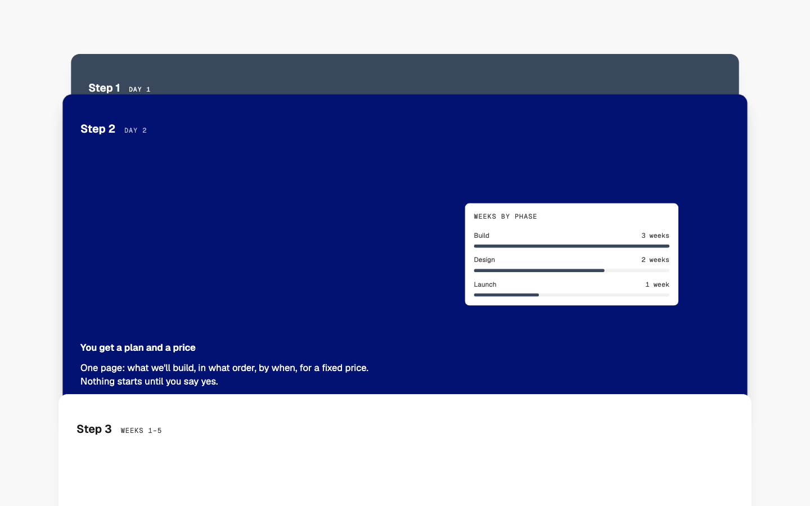
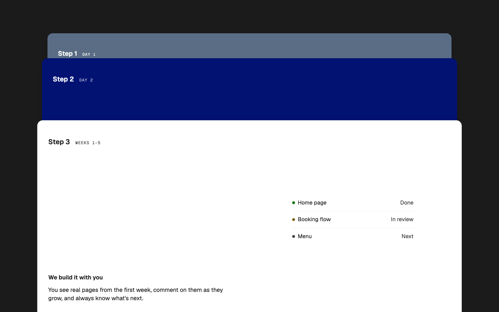
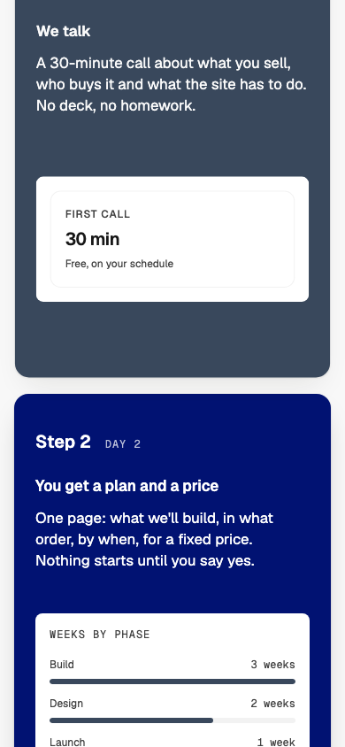

# Steps — Stacked Cards

status: approved

After Understory's stacked steps (details.so, https://www.details.so/inspo/understory-b9f3e8). Nothing copied but the idea: each step is a wide card that sticks as you scroll, the next one slides up over it, and a strip of every earlier card ("Step 1", "Step 2") stays showing above, like a stack of index cards.
**File:** `StepsStackedCards.tsx` (copy it). **Example:** `example.tsx`, a studio's four steps from first call to launch, each with a small WMDS composition of what the step produces (licence-free).

A "how it works" section on a WMDS `Band`: an eyebrow and heading on the left half, one lead sentence on the right, then the steps as an ordered list of WMDS `Card`s taking turns in the Card tones `field`, `inverse` and `light`. Each card has "Step N" and a short meta ("Week 6") on top, the step's title and copy at the bottom, and its picture on the right half.

| Light | Dark | Mobile (390) |
|---|---|---|
|  |  |  |

The screenshots are single moments of a scroll; motion frames are in the night's report.

## Use it

```tsx
import { StepsStackedCards } from "./StepsStackedCards";

<StepsStackedCards
  eyebrow="How it works"
  heading="From first call to launch in six weeks."
  intro="Four steps, one team, a fixed price."
  steps={[
    { title: "We talk", meta: "Day 1", description: "A 30-minute call about what you sell…", visual:  },
    // 3–5 steps
  ]}
/>
```

The app needs `motion` (the WMDS peer) installed.

## Slots and props

| Prop | Kind | Notes |
|---|---|---|
| `heading` | ReactNode | The section's `h2`, one short line (WMDS `type-heading-1`) |
| `eyebrow` | ReactNode | Optional: a short label above the heading (`type-eyebrow`) |
| `intro` | ReactNode | Optional: one sentence on the right half (`type-lead`, in ink) |
| `steps` | array | 3–5 steps: `title` (an `h3`), `description`, `visual` (slot), optional `meta` |
| `tone` | `"default"` (default), `"inverse"`, `"field"` | The section's WMDS Band tone; the cards keep their own tones |

## Motion

- **Stacking:** CSS `position: sticky` from md, each card 72px lower than the one before (the first at 96px), so every earlier card's "Step N" strip stays in view. Not animation.
- **Scale:** as later cards land on a card, it eases back by 3% per card (the first to 91%, the last stays at 100%), from its top edge. Motion (`motion/react`, the WMDS peer): one `useScroll` over the list, a `useTransform` per card to `scale`. Transform only.
- **Reduced motion:** the cards still stack (sticky isn't motion), but none scales (measured: no transform on any card).
- **Phones (< 768px):** a plain list, no sticking: a card taller than the screen can't stack. The picture follows the copy.

## Knobs

- `stackTop` (96) and `strip` (72) in the file: where the stack starts and how much of each earlier card stays showing. Keep `strip` at least the number row's height.
- `tones`: the Card tones the steps take in turn. The 3% step and the card height (`md:h-[min(34rem,70svh)]`).

## Adapt it

The first item is the example the gallery's Copy prompt uses.

- **Real screens or photos:** pass each `visual` as an `` (fill it: `className="size-full object-cover"`).
- **One tone:** set `tones` to one value (`["light"]`) for a calmer stack.
- **No scaling:** drop the `motion.div` and keep the `li` sticky.
- **Under a fixed site nav:** raise `stackTop` by the nav's height.

## Spacing

Full width; Band `md` spacing (48 top and bottom); eyebrow→heading 12; header→steps 40 / 64 (phone / md and up); between steps 16 on phones and 16svh from md (the scroll each card takes); card padding 24 / 32; inside a card 24 / 32.

## WMDS

Built on **@thewhatmatters/wmds 0.4.45** (npm): `Band`, `Card` (`tone`); the example adds `Stat`, `Status`, `ChartRankedBars`. Motion **13.5.1** (the WMDS peer).

- **Check change:** `npm run check` allows `motion/react` imports in patterns (Motion is a WMDS peer; Randy, 2026-10-29; the same change is on `work/pinned-parallax`), and has a rule for the new Steps type: one h2, no h1, no nav, the steps an ordered list with an h3 each.
- **WMDS-GAP: ChartRankedBars needs `max`.** Without it the bars render near-empty (3 of 3 weeks drew a sliver); the example passes `max={3}`. The default should be the largest item's value (also noted on Services — Split Index).
- **WMDS-GAP: no sticky-stack helper.** The stack is plain sticky offsets plus a scroll-linked scale; a second stacked pattern would copy both. Proposed: a WMDS `Stack` (or `useStackScale`) on the Motion peer, with the reduced-motion rule built in.
- **WMDS-GAP: Stat's own surface inside a Card.** `Stat` brings its own tile, so in a Card it reads as a box in a box (step 1's picture). Proposed: `Stat` `surface="none"`.
