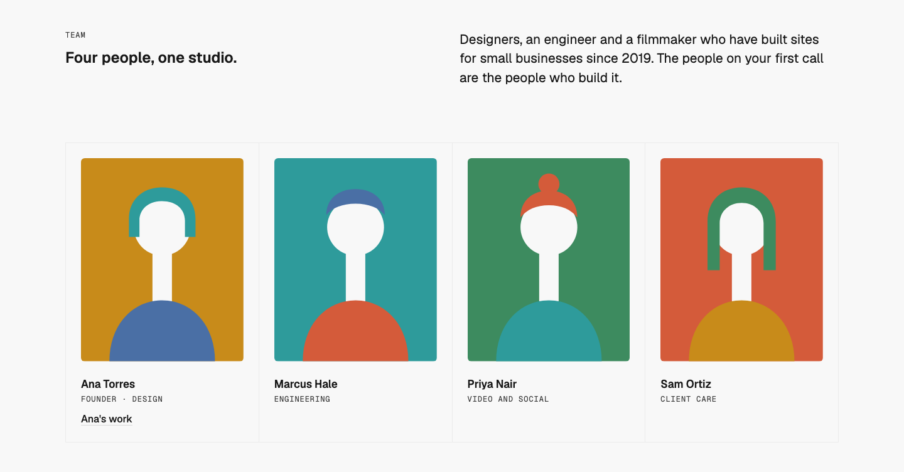
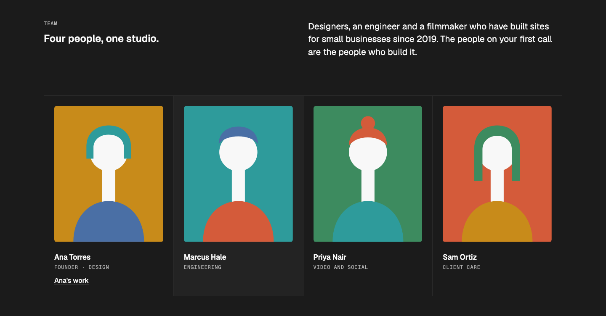
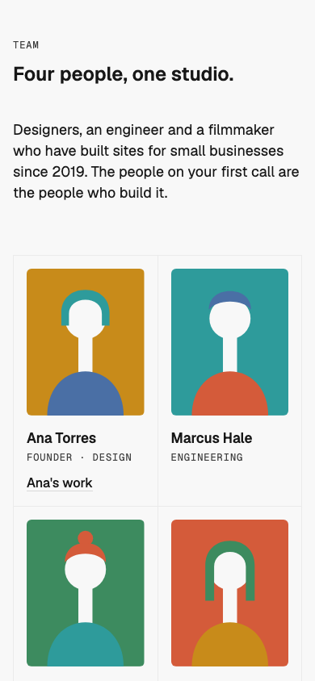

# Team — Ruled Grid

status: approved

After Heron AI's "Powered by technologists" (Inspiration board #9; details.so, https://www.details.so/inspo/heronaiapp-89acfb). Nothing copied but the structure: the people in ruled cells, each with a portrait, a name and a small mono role, under a heading and an intro.
**File:** `TeamRuledGrid.tsx` (copy it). **Example:** `example.tsx`, a studio of four made-up people with flat cut-paper busts drawn in SVG (licence-free stand-ins; a client page uses real photos).

A WMDS `Band`: eyebrow and heading on the left half, a short intro on the right half (column 7). Under them, the people in ruled cells that share their rules, two across on phones and four from md: a 4:5 portrait, the name (`h3`), the role in `type-eyebrow`, and an optional link. The cell under the pointer takes a quiet fill. No other motion.

| Light | Dark (hover on the second cell) | Mobile (390) |
|---|---|---|
|  |  |  |

## Use it

```tsx
import { TextLink } from "@thewhatmatters/wmds";
import { TeamRuledGrid } from "./TeamRuledGrid";

<TeamRuledGrid
  heading="Four people, one studio."
  intro="The people on your first call are the people who build it."
  people={[
    { name: "Ana Torres", role: "Founder · Design", portrait: , link: <TextLink href="/work">Ana's work</TextLink> },
    // 2–8 people
  ]}
/>
```

## Slots and props

| Prop | Kind | Notes |
|---|---|---|
| `heading` | ReactNode | The section's `h2`, one short line (WMDS `type-heading-1`) |
| `eyebrow` | ReactNode | Optional: a short label above the heading |
| `intro` | ReactNode | Optional: a sentence or two on the right half (`type-lead`) |
| `people` | array | 2–8 people: `name` (an `h3`), `role` (short), `portrait` (slot: an `` cropped 4:5; `alt=""` when the name beside it says enough), optional `link` (a WMDS `TextLink`) |
| `tone` | `"default"` (default), `"inverse"`, `"field"` | The WMDS Band tone |

## Behaviour

- **Hover:** the cell under the pointer fills with the text colour at 4% over 150ms; nothing under reduced motion. Cells aren't links; a person's `link` is.
- **Layout:** 2 across on phones, 4 from md; a ruled list (`ul`), each person an `li` with an `h3`.

## Knobs

- `md:grid-cols-4` (three across: `md:grid-cols-3`), `aspect-[4/5]` on the portrait, cell padding `p-4` / `md:p-6`.

## Adapt it

The first item is the example the gallery's Copy prompt uses.

- **Real photos:** one per person, the same crop and light; `object-cover` fills the 4:5 frame.
- **Three people:** set the grid to `md:grid-cols-3` in your copy.
- **No links:** leave `link` out.

## Spacing

Full width; Band `md` spacing (48 top and bottom); header → grid 40 / 64 (phone / md and up); cell padding 16 / 24; portrait → name 16 / 24; name → role 4; role → link 12.

## WMDS

Built on **@thewhatmatters/wmds 0.4.48** (npm): `Band`; the example adds `TextLink`, and scopes its stand-in portraits to the WMDS light palette (`data-theme="light"`) so their faces stay light in dark mode. No Motion, no new library.

- **Check change:** `npm run check` has a rule for the new Team type (one h2, the people as a list with an h3 each, no h1, no nav).
- **WMDS-GAP: no hover fill token for a static cell.** The cell uses the text colour at 4% via `color-mix` (the same value as WMDS's light backdrop); WMDS's `--color-overlay-hover` is for controls. Proposed: a `--color-background-hover` token for ruled cells and rows.
