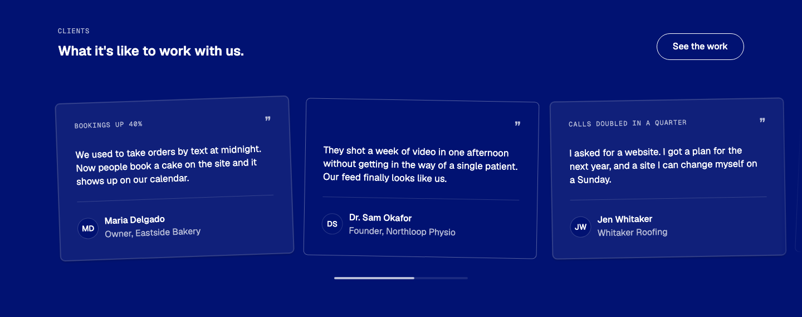
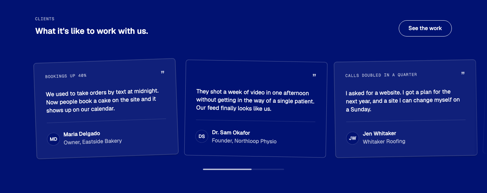
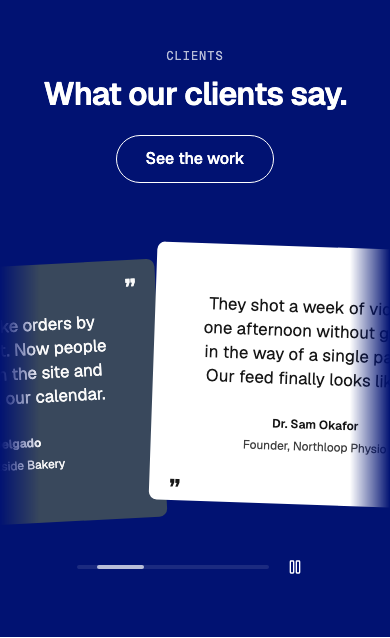

# Testimonial — Tilted Cards

status: draft

After Griflan's "Client Confessions" (details.so, https://www.details.so/inspo/griflan-99d0f7), and the claim tickets stacked at slight angles on Buck's Sauce (Inspiration board). Nothing copied but the idea: quotes as cards laid down at small, uneven angles, in a row you drag.
**File:** `TestimonialTiltedCards.tsx` (copy it). **Example:** `example.tsx`, with made-up clients and quotes and no photos (WMDS `Avatar` shows initials).

A WMDS `Band` (the inverse field by default) with an eyebrow, a heading and one CTA on top, then the quotes in a WMDS `Carousel` that runs to the page edges. Each card holds an optional result line ("Bookings up 40%") with a quiet quotation mark in its corner, the quote, and who said it. Cards alternate between a raised card and an open outline, and between four small angles (none past 2.5°), so the row reads like cards laid on a table.

| Light | Dark | Mobile (390) |
|---|---|---|
|  |  |  |

The section sits on the brand's inverse surface in both themes, so light and dark look the same; pass `tone="default"` to follow the page theme.

## Use it

```tsx
import { Button } from "@thewhatmatters/wmds";
import { TestimonialTiltedCards } from "./TestimonialTiltedCards";

<TestimonialTiltedCards
  eyebrow="Clients"
  heading="What it's like to work with us."
  actions={<Button role="outline" size="lg" render={<a href="/work" />}>See the work</Button>}
  quotes={[
    { result: "Bookings up 40%", quote: "Now people book a cake on the site…", name: "Maria Delgado", role: "Owner, Eastside Bakery" },
    // 4–8 quotes
  ]}
/>
```

## Slots and props

| Prop | Kind | Notes |
|---|---|---|
| `heading` | ReactNode | The section's `h2`, one short line (WMDS `type-heading-1`) |
| `eyebrow` | ReactNode | Optional: a short label above the heading (`type-eyebrow`) |
| `actions` | slot, optional | One CTA at the heading row's end (under it on phones): a WMDS outline `<Button size="lg">` |
| `quotes` | array | 4–8 quotes: `quote` (20–45 words, no quotation marks), `name`, optional `role`, `avatarSrc`, `result` |
| `tone` | `"inverse"` (default), `"field"`, `"default"` | The WMDS Band tone; everything inside re-skins with it |

## Behaviour

- **The row** is WMDS `Carousel` (`bleed`, scrubber centred under the row, Randy 2026-10-29): drag, trackpad, touch and keyboard from WMDS, named by the heading. Cards are 85% of the row on phones, half on tablet, a third on desktop, so the next card always peeks.
- **Each quote** is a `figure` with a `blockquote` and a `figcaption` (name, role, avatar). The quotation mark is decorative (`aria-hidden`).
- **Tilt** is a still `rotate` on each card, with 16px of room above and below so the corners clear the row's clip. Nothing animates; with reduced motion nothing changes.

## Knobs

- The Band tone sets the field, card surface (`bg-surface`), borders and text; brands change them through WMDS colour knobs.
- `tilts` and `cardKinds` in the file: the four angles and the two card kinds, repeating.

## Adapt it

The first item is the example the gallery's Copy prompt uses.

- **No tilt:** empty the `tilts` array's values (`""`) for a calm, straight row.
- **On the page background:** `tone="default"`.
- **With photos:** pass `avatarSrc` per quote (square, at least 96px).
- **Three quotes or fewer:** don't use a row; put them in a grid of three instead.

## Spacing

Full width; WMDS Band `md` spacing (48 top and bottom); eyebrow→heading 12; heading row→cards 40 on phones, 64 from md (cards' 16px clearance included); card padding 24 / 32 (phone / md and up); inside a card 24 between parts.

## WMDS

Built on **@thewhatmatters/wmds 0.4.31** (npm): `Band`, `Carousel`, `Avatar`; the example adds `Button`.

- **WMDS-GAP: no card tones.** Griflan alternates two strong card colours (paper on ink, then a brand colour). WMDS has tones only for a whole `Band`; a card can't take the inverse or field tone, so the pattern alternates a raised card with an outline instead of patching tone variables onto a `div`. Proposed: a `tone` prop on `Card` (the same `data-tone` remap `Band` uses).
- **WMDS-GAP: no quote part.** There's no WMDS `Quote` / testimonial atom (mark, quote, attribution), so the pattern composes `figure` + `blockquote` + `figcaption` with `Avatar`. Fine for now; worth a WMDS part if a second testimonial pattern needs the same markup.
